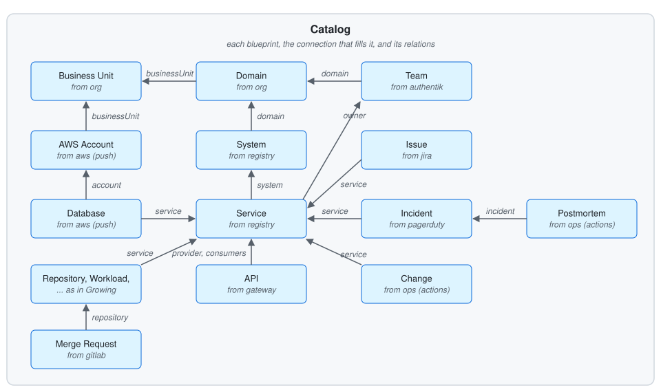
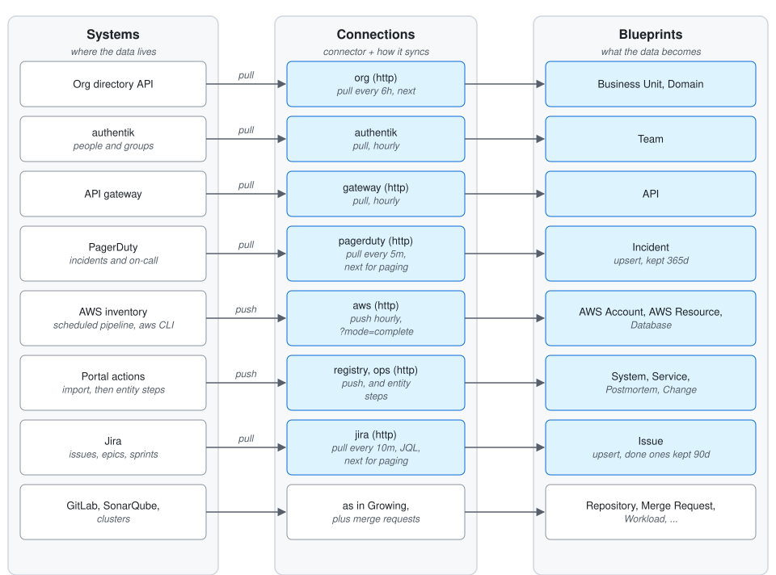
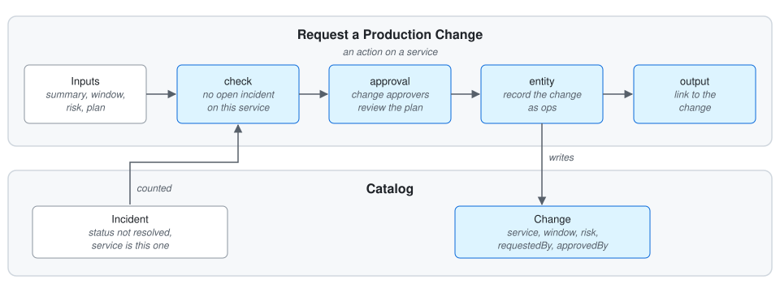
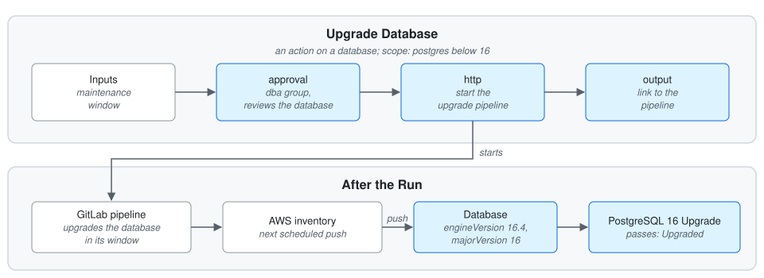

# At Scale

A portal across business units, for development and operations alike: ownership that rolls up from service to business unit, APIs and who calls them, databases and compliance, a migration tracked to the last database, incidents, postmortems and production changes recorded where people already look, and each developer's day-to-day work. Jira joins GitLab, AWS, Kubernetes and the rest, so the whole developer platform sits in one portal. It builds on [Growing](growing.md).

## The Need

- During an incident, finding a service's owner, its on-call, and what changed lately takes several tools.
- Postmortems are promised and forgotten; nobody can see which incidents still lack one.
- Production changes are approved in chat, with no record to check when something breaks.
- Compliance asks which databases hold restricted data, and whether each is encrypted and backed up. A spreadsheet answers, already out of date.
- PostgreSQL 13 is leaving support, and databases owned by many teams have to move to 16. The migration's owners need to see who's left.
- An API's owners can't tell who calls it before they deprecate a version.
- A new team waits days for its groups, repositories and access.
- Developers check Jira, GitLab and the portal separately to see what's theirs today: issues assigned to them, reviews they owe, and checks their team is failing.

## The Systems

- **Org directory**: the people system's API, which knows the business units and the domains inside them. Reorganizations happen there first.
- **authentik**: people and groups, as in Growing. Team names now have spaces, so each team group carries a short `slug` attribute.
- **API gateway**: every API version it serves, and which services subscribe to each.
- **AWS**: as in Getting Started, with more detail: each account's business unit and whether it may hold restricted data, and each RDS database's engine, version, encryption and backups.
- **PagerDuty**: incidents and on-call. Each PagerDuty service is named after its catalog service, and routes to the owning team's escalation policy.
- **Jira**: planned work for every team: issues, epics and sprints. Each team has a Jira project, and each service is a component in its owner's project.
- **GitLab** as in [Growing](growing.md#the-systems), now with its merge requests, their authors and reviewers. GitLab usernames are the local part of people's email, so jo@acme.example is jo.
- **SonarQube** and **Kubernetes** as in [Growing](growing.md#the-systems).

## The Catalog



New at this stage:

- **Business Unit** and **Domain**: the org directory's structure, so everything rolls up to a business unit without a list to keep.
- **System**: services that ship together, such as checkout. Held in the registry, like services.
- **API**: one API version on the gateway, with the service providing it and the services calling it.
- **AWS Account** gains a business unit and a `restricted` flag. **Database** is one RDS instance with what compliance and the upgrade need.
- **Incident**: one PagerDuty incident, linked to the service it hit.
- **Postmortem**: the write-up of one incident. Nothing else holds it, so an action creates it in the portal, linked to its incident and service.
- **Change**: one approved production change, recorded by the action that asked for it, with who approved it.
- **Issue**: one Jira issue, linked to the service named by its component, and through it to the team. It's what people are working on.
- **Merge Request**: one GitLab merge request, with its author and reviewers, so people see the reviews they owe.
- **Team** gains its Jira project, and **Service** gains `system`, `dataClassification`, its PagerDuty service and, through its owner, its Jira project. Workloads, repositories, pipelines and the rest stay as in [Growing](growing.md#the-catalog).

### Structure: Domain and Service Additions

<details>
<summary>Domain blueprint</summary>

```yaml
kind: Blueprint
metadata:
  identifier: domain
  title: Domain
  icon: layers
spec:
  properties:
    businessUnit:
      title: Business Unit
      relation: business-unit
    lead:
      title: Lead
      type: string
      format: email
  sources:
    - connection: org
      resource: domains
      entity:
        identifier: .slug
        title: .name
        properties:
          businessUnit: .parent.slug
          lead: .lead.email
```

</details>

<details>
<summary>Service: what's added</summary>

```yaml
properties:
  system:
    relation: system
  dataClassification:
    title: Data Classification
    type: string
    enum:
      - public
      - internal
      - confidential
      - restricted
    display:
      as: badge
      colors:
        confidential: amber
        restricted: red
  pagerdutyService:
    title: PagerDuty Service
    type: string
    display:
      hidden: true
  escalationPolicy:
    title: Escalation Policy
    type: string
    format: uri
  domain:
    title: Domain
    lookup: system.domain.title
  businessUnit:
    title: Business Unit
    lookup: system.domain.businessUnit.title
```

</details>

- A lookup follows up to 3 relations, so a service reads its business unit through system and domain.
- `pagerdutyService` holds the PagerDuty service's ID, such as `P1ABCDE`, for Page the On-Call. Hidden from pages, like `projectId` on repositories.

### API

<details>
<summary>API blueprint</summary>

```yaml
kind: Blueprint
metadata:
  identifier: api
  title: API
  icon: plug
spec:
  properties:
    provider:
      title: Provider
      relation: service
    consumers:
      title: Consumers
      relation: service
      many: true
    version:
      title: Version
      type: string
    lifecycle:
      title: Lifecycle
      type: string
      enum:
        - beta
        - stable
        - deprecated
      display:
        as: badge
        colors:
          beta: blue
          stable: green
          deprecated: amber
    specUrl:
      title: Spec
      type: string
      format: uri
    team:
      title: Team
      lookup: provider.owner.title
  sources:
    - connection: gateway
      resource: apis
      entity:
        identifier: .name + "-" + .version  # orders-v2
        title: .displayName + " " + .version
        properties:
          provider: .labels.service
          consumers: '[.subscriptions[].service] | unique'
          version: .version
          lifecycle: .lifecycle
          specUrl: .specUrl
```

</details>

### Database

<details>
<summary>Database blueprint</summary>

```yaml
kind: Blueprint
metadata:
  identifier: database
  title: Database
  icon: database
spec:
  properties:
    service:
      relation: service
    account:
      relation: aws-account
    engine:
      title: Engine
      type: string
    engineVersion:
      title: Engine Version
      type: string
    majorVersion:
      title: Major Version
      type: integer
      compute: '(.engineVersion // "0") | split(".")[0] | tonumber'
    encrypted:
      title: Encrypted at Rest
      type: boolean
    backupDays:
      title: Backups Kept
      type: integer
      display:
        unit: days
    environment:
      title: Environment
      lookup: account.environment
    compliance:
      type: scorecard
      scorecard: data-compliance
    upgrade:
      type: scorecard
      scorecard: postgres-16
  sources:
    - connection: aws
      resource: databases
      entity:
        identifier: .arn
        title: .name
        properties:
          service: .tags.service
          account: .account
          engine: .engine
          engineVersion: .version
          encrypted: .encrypted
          backupDays: .backupDays
```

</details>

- `majorVersion` is computed from `engineVersion` ("13.14" gives 13), so a scorecard and an action's scope can compare it as a number.
- Each RDS instance is also an AWS resource, as in Getting Started; the database blueprint adds what compliance and the upgrade read.
- The AWS account blueprint gains a `businessUnit` relation and a `restricted` flag, for accounts cleared for restricted data.

### Incident, Postmortem and Change

Incidents come from PagerDuty and grow with every sync, so they keep a year with [retention](../syncing.md#keeping-history-in-check). Postmortems and changes come from actions, through a push-only `ops` connection.

<details>
<summary>Incident blueprint</summary>

```yaml
kind: Blueprint
metadata:
  identifier: incident
  title: Incident
  icon: siren
spec:
  properties:
    service:
      relation: service
    status:
      title: Status
      type: string
      enum:
        - triggered
        - acknowledged
        - resolved
      display:
        as: badge
        colors:
          triggered: red
          acknowledged: amber
          resolved: green
    urgency:
      title: Urgency
      type: string
      enum:
        - high
        - low
    openedAt:
      title: Opened
      type: string
      format: date-time
    resolvedAt:
      title: Resolved
      type: string
      format: date-time
    minutesToResolve:
      title: Minutes to Resolve
      type: number
    url:
      title: PagerDuty
      type: string
      format: uri
    team:
      title: Team
      lookup: service.owner.title
  retention:
    by: openedAt
    keep: 365d
  sources:
    - connection: pagerduty
      resource: incidents
      mode: upsert
      entity:
        identifier: .id
        title: .title
        properties:
          service: .service.summary | ascii_downcase  # PagerDuty services are named after catalog services
          status: .status
          urgency: .urgency
          openedAt: .created_at
          resolvedAt: 'if .status == "resolved" then .last_status_change_at else null end'
          minutesToResolve: 'if .status == "resolved" then ((.last_status_change_at | fromdate) - (.created_at | fromdate)) / 60 | floor else null end'
          url: .html_url
```

</details>

<details>
<summary>Postmortem and Change blueprints</summary>

```yaml
kind: Blueprint
metadata:
  identifier: postmortem
  title: Postmortem
  icon: notebook-pen
spec:
  properties:
    incident:
      relation: incident
    service:
      relation: service
    status:
      title: Status
      type: string
      enum:
        - drafting
        - published
      display:
        as: badge
        colors:
          drafting: amber
          published: green
    rootCause:
      title: Root Cause
      type: string
      enum:
        - code-change
        - config-change
        - capacity
        - dependency
        - other
    document:
      title: Document
      type: string
      format: uri
    author:
      title: Author
      type: string
      format: email
    team:
      title: Team
      lookup: service.owner.title
  sources:
    - connection: ops
      resource: postmortems
      entity:
        identifier: .incident
        title: .title
        properties:
          incident: .incident
          service: .service
          status: .status
          rootCause: .rootCause
          document: .document
          author: .author
```

```yaml
kind: Blueprint
metadata:
  identifier: change
  title: Change
  icon: calendar-check
spec:
  properties:
    service:
      relation: service
    window:
      title: Window
      type: string
      format: date-time
    risk:
      title: Risk
      type: string
      enum:
        - low
        - medium
        - high
      display:
        as: badge
        colors:
          low: green
          medium: amber
          high: red
    plan:
      title: Plan
      type: string
      format: markdown
    requestedBy:
      title: Requested By
      type: string
      format: email
    approvedBy:
      title: Approved By
      type: array
    team:
      title: Team
      lookup: service.owner.title
  retention:
    by: window
    keep: 365d
  sources:
    - connection: ops
      resource: changes
      mode: upsert
      entity:
        identifier: .id
        title: .summary
        properties:
          service: .service
          window: .window
          risk: .risk
          plan: .plan
          requestedBy: .requestedBy
          approvedBy: .approvedBy
```

</details>

- A postmortem's identifier is its incident's, so an incident has at most one.
- Changes keep a year by their window; postmortems stay.

### Issue and Merge Request

Both keep open ones for good and let finished ones go: done issues 90 days after their last update, merged or closed merge requests after 30 days.

<details>
<summary>Team and Service: what's added</summary>

```yaml
kind: Blueprint
metadata:
  identifier: team
  title: Team
  icon: users
spec:
  properties:  # added to Growing's
    jiraProject:
      title: Jira Project
      type: string
  sources:
    - connection: authentik
      resource: groups
      filter: .attributes.team == true
      entity:
        identifier: .attributes.slug
        title: .name
        properties:  # added to Growing's
          jiraProject: .attributes.jiraProject   # PAY
```

</details>

<details>
<summary>Service: Jira project</summary>

```yaml
properties:
  jiraProject:
    title: Jira Project
    lookup: owner.jiraProject
```

</details>

<details>
<summary>Issue and Merge Request blueprints</summary>

```yaml
kind: Blueprint
metadata:
  identifier: issue
  title: Issue
  icon: ticket
spec:
  properties:
    service:
      relation: service
    type:
      title: Type
      type: string
    status:
      title: Status
      type: string
    statusCategory:
      title: Progress
      type: string
      enum:
        - new
        - indeterminate
        - done
      display:
        as: badge
        titles:
          new: To Do
          indeterminate: In Progress
          done: Done
        colors:
          new: gray
          indeterminate: blue
          done: green
    priority:
      title: Priority
      type: string
    assignee:
      title: Assignee
      type: string
      format: email
    sprint:
      title: Sprint
      type: string
    lastUpdated:
      title: Updated
      type: string
      format: date-time
    url:
      title: Jira
      type: string
      format: uri
    team:
      title: Team
      lookup: service.owner.title
  retention:
    by: lastUpdated
    keep: 90d
    rules:
      - filter:
          not:
            property: statusCategory
            op: eq
            value: done
        keep: 520w
  sources:
    - connection: jira
      resource: issues
      mode: upsert
      entity:
        identifier: .key                                         # PAY-1234
        title: .fields.summary
        properties:
          service: '[.fields.components[]?.name][0]'              # a component named after the service
          type: .fields.issuetype.name
          status: .fields.status.name
          statusCategory: .fields.status.statusCategory.key
          priority: .fields.priority.name
          assignee: .fields.assignee.emailAddress
          sprint: '[.fields.customfield_10020[]? | select(.state == "active") | .name][0]'
          lastUpdated: '.fields.updated | sub("(?<h>[+-][0-9]{2})(?<m>[0-9]{2})$"; "\(.h):\(.m)")'
          url: '"https://acme.atlassian.net/browse/" + .key'
```

```yaml
kind: Blueprint
metadata:
  identifier: merge-request
  title: Merge Request
  icon: git-pull-request
spec:
  properties:
    repository:
      relation: repository
    state:
      title: State
      type: string
      enum:
        - opened
        - merged
        - closed
        - locked
      display:
        as: badge
        colors:
          opened: blue
          merged: green
          closed: gray
    draft:
      title: Draft
      type: boolean
    author:
      title: Author
      type: string
      format: email
    reviewers:
      title: Reviewers
      type: array
    lastUpdated:
      title: Updated
      type: string
      format: date-time
    url:
      title: GitLab
      type: string
      format: uri
    team:
      title: Team
      lookup: repository.owner.title
  retention:
    by: lastUpdated
    keep: 30d
    rules:
      - filter:
          property: state
          op: eq
          value: opened
        keep: 520w
  sources:
    - connection: gitlab
      resource: merge_requests
      mode: upsert
      entity:
        identifier: ._project + "!" + (.iid | tostring)   # acme/payments/api!42
        title: .title
        properties:
          repository: ._project
          state: .state
          draft: .draft
          author: .author.username + "@acme.example"
          reviewers: '[.reviewers[]?.username + "@acme.example"]'
          lastUpdated: .updated_at
          url: .web_url
```

</details>

- `assignee`, `author` and `reviewers` hold emails, so filters compare them with `$me`.
- Jira gives times such as 2026-11-17T09:12:33.000+0000; the `sub` adds the colon a date-time needs.
- `customfield_10020` is where Jira Cloud keeps sprints; the active one is the issue's sprint.

### What People See

- **Service page**: an Operations tab with open incidents, recent changes and postmortems; an APIs tab with what it provides and what it calls; a Data tab with its databases. A Work tab lists its open issues and merge requests. Page the On-Call, Report a Bug and Request a Production Change run from here.
- **Incident page**: status, urgency and a link to PagerDuty; Start a Postmortem runs from here once it's resolved, and the Relations tab shows its postmortem.
- **API page**: its consumers on the overview, each linking to its service and owner, so before deprecating a version its owners know whom to tell.
- **Business unit page**: its services by domain, and the state of its databases.

<details>
<summary>Service page: Operations, APIs and Data tabs</summary>

```yaml
spec:
  entity:
    queries:
      openIncidents:
        blueprint: incident
        filter:
          and:
            - property: service
              op: eq
              value: $entity
            - property: status
              op: ne
              value: resolved
      changes:
        blueprint: change
        filter:
          property: service
          op: eq
          value: $entity
      postmortems:
        blueprint: postmortem
        filter:
          property: service
          op: eq
          value: $entity
      provides:
        blueprint: api
        filter:
          property: provider
          op: eq
          value: $entity
      calls:
        blueprint: api
        filter:
          property: consumers
          op: contains
          value: $entity
      databases:
        blueprint: database
        filter:
          property: service
          op: eq
          value: $entity
    tabs:
      operations:
        title: Operations
        widgets:
          open:
            type: table
            title: Open Incidents
            query: openIncidents
            columns:
              - path: status
              - path: urgency
              - path: openedAt
            rowLink:
              url: "{{ url }}"
          changes:
            type: table
            title: Recent Changes
            query: changes
            columns:
              - path: window
              - path: risk
              - path: requestedBy
            sort: -window
          postmortems:
            type: table
            title: Postmortems
            query: postmortems
            columns:
              - path: status
              - path: rootCause
      apis:
        title: APIs
        widgets:
          provides:
            type: table
            title: Provides
            query: provides
            columns:
              - path: lifecycle
              - path: consumers
            rowLink:
              url: "{{ specUrl }}"
          calls:
            type: table
            title: Calls
            query: calls
            columns:
              - path: provider
              - path: lifecycle
      data:
        title: Data
        when:
          property: dataClassification
          op: exists
        widgets:
          list:
            type: table
            title: Databases
            query: databases
            columns:
              - path: engineVersion
              - path: environment
              - path: compliance
```

</details>

<details>
<summary>Business unit page: Services and Data Stores tabs</summary>

```yaml
spec:
  entity:
    queries:
      services:
        blueprint: service
        filter:
          property: system.domain.businessUnit
          op: eq
          value: $entity
      databases:
        blueprint: database
        filter:
          property: account.businessUnit
          op: eq
          value: $entity
    tabs:
      services:
        title: Services
        widgets:
          byDomain:
            type: matrix
            title: Services by Domain
            query: services
            groupBy: domain
            measures:
              - title: Services
              - title: Critical
                share:
                  property: tier
                  op: eq
                  value: critical
      data:
        title: Data Stores
        widgets:
          compliance:
            type: scorecard
            title: Data Store Compliance
            scorecard: data-compliance
            query: databases
          upgrade:
            type: scorecard
            title: PostgreSQL 16 Upgrade
            scorecard: postgres-16
            query: databases
```

</details>

- Filters follow up to 3 relations too: a database reaches its business unit through its account, not through service, system and domain.

<details>
<summary>Service page: Work tab</summary>

```yaml
spec:
  entity:
    queries:
      openIssues:
        blueprint: issue
        filter:
          and:
            - property: service
              op: eq
              value: $entity
            - not:
                property: statusCategory
                op: eq
                value: done
      openMergeRequests:
        blueprint: merge-request
        filter:
          and:
            - property: repository
              op: eq
              value: $entity.repository
            - property: state
              op: eq
              value: opened
    tabs:
      work:
        title: Work
        widgets:
          issues:
            type: table
            title: Open Issues
            query: openIssues
            columns:
              - path: statusCategory
              - path: priority
              - path: assignee
              - path: sprint
            sort: -lastUpdated
            rowLink:
              url: "{{ url }}"
          mergeRequests:
            type: table
            title: Open Merge Requests
            query: openMergeRequests
            columns:
              - path: author
              - path: reviewers
              - path: lastUpdated
            sort: -lastUpdated
            rowLink:
              url: "{{ url }}"
```

</details>

## Getting Data In



### Org Directory: Pull With Paging

<details>
<summary>Org directory connection</summary>

```yaml
kind: Connection
metadata:
  identifier: org
  title: Org Directory
spec:
  connector:
    type: http
    config:
      resources:
        units:
          url: https://org.acme.example/api/v1/units?type=business-unit
          items: .data[]
          next: .links.next
          headers:
            Authorization:
              env: GP_SECRET_ORG_TOKEN
        domains:
          url: https://org.acme.example/api/v1/units?type=domain
          items: .data[]
          next: .links.next
          headers:
            Authorization:
              env: GP_SECRET_ORG_TOKEN
  sync:
    interval: 6h
```

</details>

- `next` gives the next page's URL, or null on the last page.
- The API gateway connection has the same shape, with one `apis` resource, hourly.

### PagerDuty: Pull With Paging

<details>
<summary>PagerDuty connection</summary>

```yaml
kind: Connection
metadata:
  identifier: pagerduty
  title: PagerDuty
spec:
  connector:
    type: http
    config:
      resources:
        incidents:
          url: https://api.pagerduty.com/incidents?limit=100&sort_by=created_at:desc
          items: .incidents[]
          next: 'if .more then "?limit=100&sort_by=created_at:desc&offset=\(.offset + .limit)" else null end'
          headers:
            Authorization:  # "Token token=..."
              env: GP_SECRET_PAGERDUTY_TOKEN
            Accept: application/vnd.pagerduty+json;version=2
  sync:
    interval: 5m
```

</details>

- `next` builds the next page's URL from the page's `offset` and `limit`, and stops when `more` is false.
- Each sync reads PagerDuty's recent incidents; `mode: upsert` keeps older ones until retention removes them after a year.

### AWS: More From the Same Push

The inventory pipeline from [Getting Started](getting-started.md#getting-data-in) also reads each account's tags from AWS Organizations, and lists RDS instances with `aws rds describe-db-instances`. The connection gains a `databases` resource.

<details>
<summary>AWS connection</summary>

```yaml
kind: Connection
metadata:
  identifier: aws
  title: AWS
spec:
  connector:
    type: http
    config:
      resources:
        accounts:
          push:
            items: .body.accounts[]
        resources:
          push:
            items: .body.resources[]
        databases:
          push:
            items: .body.databases[]
```

</details>

<details>
<summary>What the inventory pushes</summary>

```json
{
  "accounts": [{"id": "111111111111", "name": "payments-prod", "environment": "production",
                "businessUnit": "commerce", "restricted": true}],
  "resources": [{"arn": "arn:aws:lambda:eu-west-1:111111111111:function:payments-api", "account": "111111111111",
                 "tags": {"repository": "acme/payments/api", "environment": "production"}}],
  "databases": [{"arn": "arn:aws:rds:eu-west-1:111111111111:db:orders", "name": "orders", "account": "111111111111",
                 "engine": "postgres", "version": "13.14", "encrypted": true, "backupDays": 7,
                 "tags": {"service": "orders"}}]
}
```

</details>

- Still posted with `?mode=complete`, so a database deleted in AWS leaves the catalog with the next push.
- Every database carries a `service` tag; the compliance scorecard catches those without one.

### Jira: Pull With JQL

The connection reads Jira's search with a JQL query, a page of 100 at a time.

<details>
<summary>Jira connection</summary>

```yaml
kind: Connection
metadata:
  identifier: jira
  title: Jira
spec:
  connector:
    type: http
    config:
      resources:
        issues:
          url: https://acme.atlassian.net/rest/api/3/search/jql?jql=statusCategory%20!%3D%20Done%20OR%20updated%20%3E%3D%20-30d&fields=summary,issuetype,status,priority,assignee,components,updated,customfield_10020&maxResults=100
          items: .issues[]
          next: 'if .nextPageToken then "?jql=statusCategory%20!%3D%20Done%20OR%20updated%20%3E%3D%20-30d&fields=summary,issuetype,status,priority,assignee,components,updated,customfield_10020&maxResults=100&nextPageToken=\(.nextPageToken | @uri)" else null end'
          maxPages: 500
          headers:
            Authorization:  # "Basic " and base64 of the account's email:API token
              env: GP_SECRET_JIRA_AUTH
  sync:
    interval: 10m
```

</details>

- The query reads open issues and anything updated in the last 30 days. `{{ $since }}` would fill in a time such as 2026-11-17T09:00:00Z, which JQL doesn't take (it takes 2026-11-17 09:00), so the query uses Jira's relative date instead; `mode: upsert` and retention keep the rest.
- `next` builds the next page's URL from `nextPageToken`, and stops on the last page, which has none.
- `maxPages` is raised from its default of 100, since open issues across every team run to many pages.
- The `Authorization` secret holds the whole header value.

### Portal Actions: Registry and Ops

- The registry gains a `systems` resource beside `domains` and `services`.
- A second push-only connection, `ops`, receives what actions record: postmortems and changes.

<details>
<summary>Ops connection</summary>

```yaml
kind: Connection
metadata:
  identifier: ops
  title: Operations Records
spec:
  connector:
    type: http
    config:
      resources:
        postmortems:
          push:
            items: .body.postmortems[]
        changes:
          push:
            items: .body.changes[]
```

</details>

- GitLab, SonarQube and the clusters come in as in [Growing](growing.md#getting-data-in), and the GitLab connection now also reads `merge_requests`. As clusters multiply, split them across connections, such as one per region, so each complete push covers only its own.

## Self-Service

### Page the On-Call

Replaces "who's on call for checkout?" in chat. Anyone can raise an incident on a service from its page; PagerDuty routes it to the owners' escalation policy.

<details>
<summary>Page the On-Call action</summary>

```yaml
kind: Action
metadata:
  identifier: page-on-call
  title: Page the On-Call
spec:
  blueprint: service
  group: Operate
  scope:
    property: pagerdutyService
    op: exists
  run:
    roles:
      - member
  inputs:
    problem:
      title: What's Wrong
      type: string
      required: true
      maxLength: 200
    urgency:
      title: Urgency
      type: string
      enum:
        - high
        - low
      required: true
    details:
      title: Details
      type: string
      format: markdown
  steps:
    - id: incident
      http:
        method: POST
        url: https://api.pagerduty.com/incidents
        headers:
          Authorization:
            env: GP_SECRET_PAGERDUTY_TOKEN
          Accept: application/vnd.pagerduty+json;version=2
          From: "{{ $me.email }}"
        body:
          incident:
            type: incident
            title: $input.problem
            urgency: $input.urgency
            service:
              id: $entity.pagerdutyService
              type: service_reference
            body:
              type: incident_body
              details: "{{ $input.details }}\n\nRaised from the portal by {{ $me.name }}: {{ $run.url }}"
        output:
          url: .body.incident.html_url
    - sync:
        connection: pagerduty
        resources:
          - incidents
        mode: incremental
    - output:
        summary: Paged the on-call for {{ $entity.title }}.
        links:
          Incident: $step.incident.url
```

</details>

- `From` names the requester, so PagerDuty records who raised it; their email needs a PagerDuty user.
- The service's ID comes from the catalog, so nobody has to look up which PagerDuty service to page.
- `sync` pulls the new incident, so it's on the service's Operations tab when the run ends.

### Report a Bug

Replaces hunting for the right Jira project. Anyone can file a bug from a service's page; it lands in the owning team's project, under the service's component, with a link back to the run.

<details>
<summary>Report a Bug action</summary>

```yaml
kind: Action
metadata:
  identifier: report-bug
  title: Report a Bug
spec:
  blueprint: service
  group: Operate
  scope:
    property: jiraProject
    op: exists
  run:
    roles:
      - member
  inputs:
    summary:
      title: Summary
      type: string
      required: true
      maxLength: 200
    details:
      title: What Happened
      type: string
      required: true
    priority:
      title: Priority
      type: string
      enum:
        - Highest
        - High
        - Medium
        - Low
      required: true
  steps:
    - id: bug
      http:
        method: POST
        url: https://acme.atlassian.net/rest/api/2/issue
        headers:
          Authorization:
            env: GP_SECRET_JIRA_AUTH
        body:
          fields:
            project:
              key: $entity.jiraProject
            issuetype:
              name: Bug
            summary: $input.summary
            priority:
              name: $input.priority
            components:
              - name: $entity
            description: "{{ $input.details }}\n\nService: {{ $entity.title }}\nReported by {{ $me.name }} ({{ $me.email }}) from the portal: {{ $run.url }}"
        output:
          key: .body.key
    - sync:
        connection: jira
        resources:
          - issues
        mode: incremental
    - output:
        summary: Filed {{ $step.bug.key }} with {{ $entity.owner }}.
        links:
          Issue: https://acme.atlassian.net/browse/{{ $step.bug.key }}
```

</details>

- The project comes from the owner's `jiraProject`, so a reorganization moves where bugs land without editing the action.
- The issue is filed by the portal's Jira account; the description names who reported it.
- `sync` pulls the new issue, so it's on the service's Work tab when the run ends.

### Start a Postmortem

Replaces postmortems tracked in a spreadsheet, or not at all. On a resolved high-urgency incident, the owning team starts one: the portal opens its issue in GitLab and records the postmortem in the catalog.

<details>
<summary>Start a Postmortem action</summary>

```yaml
kind: Action
metadata:
  identifier: start-postmortem
  title: Start a Postmortem
spec:
  blueprint: incident
  group: Operate
  scope:
    and:
      - property: status
        op: eq
        value: resolved
      - property: urgency
        op: eq
        value: high
  run:
    filter:
      property: service.owner.title
      op: in
      values: $me.groups
  steps:
    - check:
        blueprint: postmortem
        filter:
          property: identifier
          op: eq
          value: $entity
        expect:
          count: 0
        message: This incident already has a postmortem; its Relations tab links to it.
    - id: issue
      http:
        method: POST
        url: https://gitlab.acme.example/api/v4/projects/acme%2Fops%2Fpostmortems/issues
        headers:
          PRIVATE-TOKEN:
            env: GP_SECRET_GITLAB_OPS_TOKEN
        body:
          title: "Postmortem: {{ $entity.title }}"
          labels: postmortem,{{ $entity.service }}
          description: |
            Incident: {{ $entity.url }}
            Service: {{ $entity.service }}
            Opened {{ $entity.openedAt }}, resolved {{ $entity.resolvedAt }}.

            ## Summary
            ## Timeline
            ## Root Cause
            ## Action Items
        output:
          url: .body.web_url
    - id: postmortem
      entity:
        operation: upsert
        connection: ops
        blueprint: postmortem
        identifier: $entity
        title: "Postmortem: {{ $entity.title }}"
        properties:
          incident: $entity
          service: $entity.service
          status: drafting
          document: $step.issue.url
          author: $me.email
    - output:
        summary: Postmortem started for {{ $entity.title }}.
        links:
          Issue: $step.issue.url
          Postmortem: $step.postmortem.url
```

</details>

- When it's written up, **Publish** on the postmortem's page sets `status` to published and records the root cause, with the same kind of `entity` step and a required `rootCause` input.
- The Operations dashboard lists postmortems still drafting, and counts root causes across published ones.

### Request a Production Change

Replaces change approvals in chat. The owning team asks from the service's page; it can't while the service has an open incident; an approver signs off; the change is recorded with who approved it.



<details>
<summary>Request a Production Change action</summary>

```yaml
kind: Action
metadata:
  identifier: request-change
  title: Request a Production Change
spec:
  blueprint: service
  group: Operate
  run:
    filter:
      property: owner.title
      op: in
      values: $me.groups
  inputs:
    summary:
      title: Summary
      type: string
      required: true
      maxLength: 120
    window:
      title: Window Start
      type: string
      format: date-time
      required: true
    risk:
      title: Risk
      type: string
      enum:
        - low
        - medium
        - high
      required: true
    plan:
      title: Plan and Rollback
      type: string
      format: markdown
      required: true
  steps:
    - check:
        blueprint: incident
        filter:
          and:
            - property: service
              op: eq
              value: $entity
            - property: status
              op: ne
              value: resolved
        expect:
          count: 0
        message: This service has an open incident; change it once the incident is resolved.
    - id: approval
      approval:
        approvers:
          groups:
            - change-approvers
        require: 1
        timeout: 72h
        message: "{{ $input.risk }}-risk change to {{ $entity.title }} at {{ $input.window }}: {{ $input.summary }}"
        review:
          - title: Plan and Rollback
            markdown: $input.plan
    - id: change
      entity:
        operation: upsert
        connection: ops
        blueprint: change
        identifier: $run.id
        title: $input.summary
        properties:
          service: $entity
          window: $input.window
          risk: $input.risk
          plan: $input.plan
          requestedBy: $me.email
          approvedBy: $step.approval.approvedBy
    - output:
        summary: Approved. Make the change from {{ $input.window }}.
        links:
          Change: $step.change.url
```

</details>

- The `check` reads PagerDuty's incidents from the catalog, so a team can't start a change in the middle of an outage.
- `approvedBy` is what the approval step gives: the approvers' emails.
- After an incident, the service's Operations tab shows the changes before it.

### Onboard a Team

Replaces a round of tickets for every new team: a group in authentik, a group in GitLab, and an approval from a manager.

<details>
<summary>Onboard Team workflow</summary>

```yaml
kind: Workflow
metadata:
  identifier: onboard-team
  title: Onboard Team
spec:
  group: Create
  run:
    roles:
      - member
  inputs:
    name:
      title: Team Name
      type: string
      required: true
    slug:
      title: Short Name
      type: string
      required: true
      pattern: "^[a-z][a-z0-9-]{2,30}$"
    domain:
      title: Domain
      relation: domain
      required: true
    channel:
      title: Chat Channel
      type: string
      required: true
  steps:
    - check:
        blueprint: team
        filter:
          property: identifier
          op: eq
          value: $input.slug
        expect:
          count: 0
        message: A team with that short name exists.
    - approval:
        approvers:
          groups:
            - engineering-managers
        require: 1
        timeout: 72h
        message: New team {{ $input.name }} in {{ $input.domain }}, asked for by {{ $me.name }}.
    - http:
        method: POST
        url: https://auth.acme.example/api/v3/core/groups/
        headers:
          Authorization:
            env: GP_SECRET_AUTHENTIK_ADMIN_TOKEN
        body:
          name: $input.name
          attributes:
            team: true
            slug: $input.slug
            domain: $input.domain
            channel: $input.channel
    - id: group
      http:
        method: POST
        url: https://gitlab.acme.example/api/v4/groups
        headers:
          PRIVATE-TOKEN:
            env: GP_SECRET_GITLAB_ADMIN_TOKEN
        body:  # under the acme group
          name: $input.name
          path: $input.slug
          parent_id: 12
        output:
          url: .body.web_url
    - sync:
        connection: authentik
        mode: incremental
    - output:
        summary: "{{ $input.name }} is set up. Add its members in authentik."
        links:
          GitLab Group: $step.group.url
```

</details>

- `sync` brings the team into the catalog before the run ends, so the person who asked can register services for it straight away.

### Request a Database

Replaces database tickets. The owning team asks from its service's page; a database administrator approves; the request lands as a merge request in the infrastructure repository.

<details>
<summary>Request Database action</summary>

```yaml
kind: Action
metadata:
  identifier: request-database
  title: Request Database
spec:
  blueprint: service
  group: Create
  run:
    filter:
      property: owner.title
      op: in
      values: $me.groups
  inputs:
    account:
      title: AWS Account
      relation: aws-account
      required: true
    name:
      title: Name
      type: string
      required: true
      pattern: "^[a-z][a-z0-9-]{2,30}$"
    size:
      title: Size
      type: string
      enum:
        - small
        - medium
        - large
      required: true
  steps:
    - check:
        blueprint: database
        filter:
          and:
            - property: account
              op: eq
              value: $input.account
            - property: title
              op: eq
              value: $input.name
        expect:
          count: 0
        message: That account already has a database with this name.
    - approval:
        approvers:
          groups:
            - dba
        require: 1
        timeout: 72h
        review:
          - title: Request
            json:
              service: $entity
              classification: $entity.dataClassification
              account: $input.account
              size: $input.size
    - http:
        method: POST
        url: https://gitlab.acme.example/api/v4/projects/acme%2Fplatform%2Fdatabases/repository/commits
        headers:
          PRIVATE-TOKEN:
            env: GP_SECRET_GITLAB_ADMIN_TOKEN
        body:
          branch: db-{{ $input.name }}
          start_branch: main
          commit_message: Add database {{ $input.name }} for {{ $entity }}
          actions:
            - action: create
              file_path: databases/{{ $input.account }}/{{ $input.name }}.yaml
              content: |
                name: {{ $input.name }}
                service: {{ $entity }}
                size: {{ $input.size }}
                engine: postgres
                version: "16"
    - id: mr
      http:
        method: POST
        url: https://gitlab.acme.example/api/v4/projects/acme%2Fplatform%2Fdatabases/merge_requests
        headers:
          PRIVATE-TOKEN:
            env: GP_SECRET_GITLAB_ADMIN_TOKEN
        body:
          source_branch: db-{{ $input.name }}
          target_branch: main
          title: Add database {{ $input.name }} for {{ $entity }}
          remove_source_branch: true
        output:
          url: .body.web_url
    - output:
        summary: Merge request opened. The database shows in the catalog after it's applied, with the next inventory push.
        links:
          Merge Request: $step.mr.url
```

</details>

- The approver sees the service's data classification beside the request, so a restricted service doesn't land in an open account.
- New databases start on PostgreSQL 16, so the migration doesn't grow.

### Upgrade a Database

The fix for the migration scorecard, on the database's own page.



<details>
<summary>Upgrade Database action</summary>

```yaml
kind: Action
metadata:
  identifier: upgrade-database
  title: Upgrade to PostgreSQL 16
spec:
  blueprint: database
  group: Operate
  scope:
    and:
      - property: engine
        op: eq
        value: postgres
      - property: majorVersion
        op: lt
        value: 16
  run:
    filter:
      property: service.owner.title
      op: in
      values: $me.groups
  inputs:
    window:
      title: Maintenance Window Start
      type: string
      format: date-time
      required: true
  steps:
    - approval:
        approvers:
          groups:
            - dba
        require: 1
        timeout: 168h
        message: Upgrade {{ $entity.title }} from {{ $entity.engineVersion }} to 16 at {{ $input.window }}?
        review:
          - title: Database
            json:
              service: $entity.service
              account: $entity.account
              environment: $entity.environment
              version: $entity.engineVersion
    - id: pipeline
      http:
        method: POST
        url: https://gitlab.acme.example/api/v4/projects/acme%2Fplatform%2Fdatabases/pipeline
        headers:
          PRIVATE-TOKEN:
            env: GP_SECRET_GITLAB_OPS_TOKEN
        body:
          ref: main
          variables:
            - key: TASK
              value: upgrade
            - key: DATABASE
              value: $entity
            - key: TARGET_VERSION
              value: "16"
            - key: WINDOW
              value: $input.window
        output:
          url: .body.web_url
    - output:
        summary: Upgrade scheduled for {{ $input.window }}.
        links:
          Pipeline: $step.pipeline.url
```

</details>

- `scope` offers it only on PostgreSQL databases below 16; once upgraded, it leaves the page.
- The catalog changes with the next inventory push, which also moves the database to Upgraded.

## Scorecards

- **PostgreSQL 16 Upgrade**: one check over the computed `majorVersion`. Every database is done or not, and the scorecard widget shows how many are left.
- **Data Store Compliance**: owned, encrypted, backed up in production, and restricted data only in restricted accounts.

<details>
<summary>PostgreSQL 16 Upgrade scorecard</summary>

```yaml
kind: Scorecard
metadata:
  identifier: postgres-16
  title: PostgreSQL 16 Upgrade
spec:
  blueprint: database
  filter:
    property: engine
    op: eq
    value: postgres
  tiers:
    - name: upgraded
      title: Upgraded
      color: green
      criteria:
        on16:
          title: On PostgreSQL 16 or Later
          check:
            property: majorVersion
            op: gte
            value: 16
          fix: Run Upgrade to PostgreSQL 16 from this page.
```

</details>

<details>
<summary>Data Store Compliance scorecard</summary>

```yaml
kind: Scorecard
metadata:
  identifier: data-compliance
  title: Data Store Compliance
spec:
  blueprint: database
  tiers:
    - name: compliant
      title: Compliant
      color: green
      criteria:
        owned:
          title: Belongs to a Service
          check:
            property: service.title
            op: exists
          fix: Tag the database with its service's name.
        encrypted:
          title: Encrypted at Rest
          check:
            property: encrypted
            op: eq
            value: true
        backups:
          title: Backups Kept 14 Days
          when:
            property: environment
            op: eq
            value: production
          check:
            property: backupDays
            op: gte
            value: 14
        restricted:
          title: Restricted Data in a Restricted Account
          when:
            property: service.dataClassification
            op: eq
            value: restricted
          check:
            property: account.restricted
            op: eq
            value: true
```

</details>

## Dashboards

- **My Day**, every member's default Home tab: their open Jira issues, the reviews they owe, their open merge requests, and their team's workloads below baseline.
- **My Services**, for teams: open incidents, postmortems still drafting, databases to upgrade or fix, and the team's self-service.
- **Operations**, for leads and SRE: open incidents, incidents and minutes to resolve by team, incidents per day, root causes, and recent changes.
- **Data and Migrations**, for leads and compliance: the upgrade, versions in use, and compliance by business unit.

<details>
<summary>My Day dashboard</summary>

```yaml
kind: Dashboard
metadata:
  identifier: my-day
  title: My Day
spec:
  order: 0
  defaultFor:
    roles:
      - member
  queries:
    myIssues:
      blueprint: issue
      filter:
        and:
          - property: assignee
            op: eq
            value: $me
          - not:
              property: statusCategory
              op: eq
              value: done
    toReview:
      blueprint: merge-request
      filter:
        and:
          - property: reviewers
            op: contains
            value: $me
          - property: state
            op: eq
            value: opened
          - not:
              property: draft
              op: eq
              value: true
    myOpen:
      blueprint: merge-request
      filter:
        and:
          - property: author
            op: eq
            value: $me
          - property: state
            op: eq
            value: opened
    belowBaseline:
      blueprint: workload
      filter:
        and:
          - property: service.owner.title
            op: in
            values: $me.groups
          - property: baseline.failed
            op: gt
            value: 0
  widgets:
    myIssues:
      type: stat
      title: My Open Issues
      value:
        query: myIssues
      link:
        query: myIssues
    toReview:
      type: stat
      title: Reviews I Owe
      value:
        query: toReview
      link:
        query: toReview
    myOpen:
      type: stat
      title: My Open Merge Requests
      value:
        query: myOpen
      link:
        query: myOpen
    belowBaseline:
      type: stat
      title: My Team's Workloads Below Baseline
      value:
        query: belowBaseline
      link:
        query: belowBaseline
    issueList:
      type: table
      title: My Issues
      query: myIssues
      columns:
        - path: statusCategory
        - path: priority
        - path: sprint
        - path: service
      sort: -lastUpdated
      rowLink:
        url: "{{ url }}"
    reviewList:
      type: table
      title: Waiting on My Review
      query: toReview
      columns:
        - path: repository
        - path: author
        - path: lastUpdated
      sort: lastUpdated
      rowLink:
        url: "{{ url }}"
```

</details>

<details>
<summary>My Services dashboard</summary>

```yaml
spec:
  inputs:
    team:
      type: relation
      relation: team
      multiple: true
      default:
        query:
          blueprint: team
          filter:
            property: title
            op: in
            values: $me.groups
  queries:
    openIncidents:
      blueprint: incident
      filter:
        and:
          - property: service.owner
            op: in
            values: $input.team
          - property: status
            op: ne
            value: resolved
    drafting:
      blueprint: postmortem
      filter:
        and:
          - property: service.owner
            op: in
            values: $input.team
          - property: status
            op: eq
            value: drafting
    toUpgrade:
      blueprint: database
      filter:
        and:
          - property: service.owner
            op: in
            values: $input.team
          - property: upgrade.failed
            op: gt
            value: 0
    notCompliant:
      blueprint: database
      filter:
        and:
          - property: service.owner
            op: in
            values: $input.team
          - property: compliance.failed
            op: gt
            value: 0
  widgets:
    openIncidents:
      type: stat
      title: Open Incidents
      value:
        query: openIncidents
      link:
        query: openIncidents
    drafting:
      type: stat
      title: Postmortems Drafting
      value:
        query: drafting
      link:
        query: drafting
    toUpgrade:
      type: stat
      title: Databases to Upgrade
      value:
        query: toUpgrade
      link:
        query: toUpgrade
    notCompliant:
      type: stat
      title: Databases Not Compliant
      value:
        query: notCompliant
      link:
        query: notCompliant
    run:
      type: actions
      title: Self-Service
      actions:
        - request-database
        - request-change
      workflows:
        - onboard-team
      width: 12
```

</details>

<details>
<summary>Operations dashboard</summary>

```yaml
spec:
  visibility:
    groups:
      - Engineering Leads
      - SRE
  queries:
    incidents:
      blueprint: incident
    open:
      blueprint: incident
      filter:
        property: status
        op: ne
        value: resolved
    lastMonth:
      blueprint: incident
      filter:
        property: openedAt
        op: within
        value: 30d
    published:
      blueprint: postmortem
      filter:
        property: status
        op: eq
        value: published
    changes:
      blueprint: change
      filter:
        property: window
        op: within
        value: 7d
  widgets:
    open:
      type: stat
      title: Open Incidents
      value:
        query: open
      link:
        query: open
    perDay:
      type: trend
      title: Incidents Per Day
      query: incidents
      date: openedAt
      range: 90d
    causes:
      type: donut
      title: Root Causes
      query: published
      groupBy: rootCause
      link:
        query: published
        group: true
    byTeam:
      type: matrix
      title: Incidents by Team, Last 30 Days
      query: lastMonth
      groupBy: team
      measures:
        - title: Incidents
        - title: High Urgency
          share:
            property: urgency
            op: eq
            value: high
        - title: P50 Minutes to Resolve
          p50: minutesToResolve
        - title: P90 Minutes to Resolve
          p90: minutesToResolve
    changes:
      type: table
      title: Changes, Last 7 Days
      query: changes
      columns:
        - path: service
        - path: risk
        - path: window
        - path: approvedBy
      sort: -window
```

</details>

<details>
<summary>Data and Migrations dashboard</summary>

```yaml
spec:
  visibility:
    groups:
      - Engineering Leads
      - Compliance
  queries:
    databases:
      blueprint: database
    postgres:
      blueprint: database
      filter:
        property: engine
        op: eq
        value: postgres
  widgets:
    upgrade:
      type: scorecard
      title: PostgreSQL 16 Upgrade
      scorecard: postgres-16
    versions:
      type: bar
      title: PostgreSQL by Major Version
      query: postgres
      groupBy: majorVersion
      sort: group
      link:
        query: postgres
        group: true
    byUnit:
      type: matrix
      title: Databases by Business Unit
      query: databases
      groupBy: account.businessUnit
      measures:
        - title: Databases
        - title: Compliant
          share:
            property: compliance
            op: eq
            value: compliant
        - title: On PostgreSQL 16
          filter:
            property: engine
            op: eq
            value: postgres
          share:
            property: upgrade
            op: eq
            value: upgraded
```

</details>

## Rollout

1. **Structure first**: business units and domains from the org directory, systems in the registry, so every service rolls up. Start with one business unit that asked for it.
2. **Day-to-day work**: Jira issues and merge requests with My Day, then Report a Bug, so developers open the portal every morning, not only when something breaks.
3. **Incidents**: PagerDuty linked to services, with Page the On-Call, so the service page becomes where an incident starts.
4. **Ops records**: Start a Postmortem and Request a Production Change, with the Operations dashboard, so what happened and what changed sit beside each other.
5. **Inventory and self-service**: databases in the AWS push, then Onboard Team and Request Database, the two longest queues.
6. **The migration and compliance**: the PostgreSQL 16 scorecard with Upgrade Database, then compliance once owners have tagged their databases.
