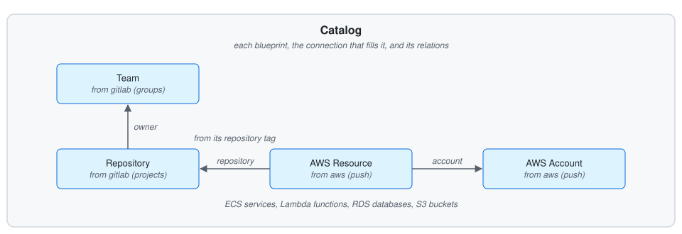
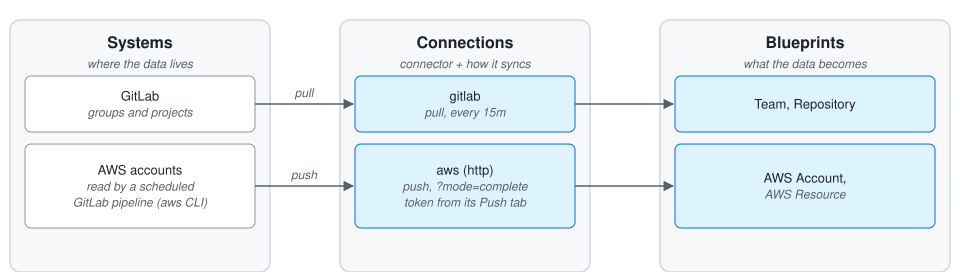
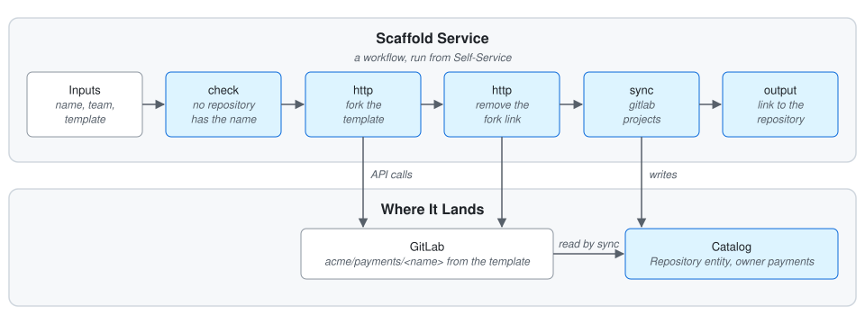

# Getting Started

A new portal: a catalog people trust, and a few chores they no longer ask for. Here the teams keep their code in GitLab and run their services on AWS.

## The Need

- Who owns a repository, or the AWS resources it runs on, lives in people's heads.
- Two people grant repository access and clean up old projects, and spend part of every day doing it.
- AWS resources nobody tagged pile up, and nobody can say whose they are.
- New services start as copies of an old repository, and each copy drifts.

The portal answers who owns what, lets people do those chores themselves, and starts every new service from a template.

## The Systems

- **GitLab** holds the code, and with it the organization: each team is a GitLab group, and each of its projects sits inside. It also runs CI, which tells the portal whether a repository builds.
- **AWS** is where services run: ECS services and Lambda functions for code, RDS databases and S3 buckets for data, spread across a production, a staging and a sandbox account. Every resource carries a `repository` tag naming the project it belongs to.

People sign in to the portal with GitLab, so their groups are their GitLab groups' full paths, such as acme/payments.

## The Catalog



- **Team**: a GitLab group directly under acme, such as acme/payments. It exists so everything else can have an owner.
- **Repository**: a GitLab project. Here a repository is the service: one repository, one deployable thing, so there's no separate service blueprint yet.
- **AWS Account**: one AWS account. It groups resources by environment, so production stands apart from the sandbox.
- **AWS Resource**: one ECS service, Lambda function, RDS database or S3 bucket. Its `repository` tag links it to its repository, and through the repository to its team, so every resource has an owner without a second list to keep.

### Team

Teams come from the GitLab connection's `groups` resource; only groups one level under acme count as teams.

<details>
<summary>Team blueprint</summary>

```yaml
kind: Blueprint
metadata:
  identifier: team
  title: Team
  icon: users
spec:
  properties:
    fullPath:
      title: GitLab Group
      type: string
    url:
      title: GitLab
      type: string
      format: uri
  sources:
    - connection: gitlab
      resource: groups
      filter: (.full_path | split("/") | length) == 2   # acme/payments, not acme or acme/payments/tools
      entity:
        identifier: .path
        title: .name
        properties:
          fullPath: .full_path
          url: .web_url
```

</details>

- `fullPath` is what sign-in lists in `$me.groups`, so filters compare people's groups with `owner.fullPath`.

### Repository

A project's group is its team, so the group's path gives the owner.

<details>
<summary>Repository blueprint</summary>

```yaml
kind: Blueprint
metadata:
  identifier: repository
  title: Repository
  icon: git-branch
spec:
  properties:
    owner:
      relation: team
      display:
        filter: true
    url:
      title: GitLab
      type: string
      format: uri
    projectId:
      title: Project ID
      type: integer
      display:
        hidden: true
    topics:
      title: Topics
      type: array
    archived:
      title: Archived
      type: boolean
    ci:
      title: CI
      type: string
      display:
        as: badge
        colors:
          success: green
          failed: red
    defaultBranchProtected:
      title: Default Branch Protected
      type: boolean
    hasRunbook:
      title: Runbook
      type: boolean
    criticalVulnerabilities:
      title: Critical Vulnerabilities
      type: integer
    lastActivityAt:
      title: Last Activity
      type: string
      format: date-time
    readiness:
      type: scorecard
      scorecard: readiness
  sources:
    - connection: gitlab
      resource: projects
      entity:
        identifier: .path_with_namespace
        title: .name
        properties:
          owner: .namespace.path
          url: .web_url
          projectId: .id
          topics: .topics
          archived: .archived
          ci: ._latestPipeline.status
          defaultBranchProtected: ._defaultBranch.protected
          hasRunbook: '(._files // []) | any(. == "RUNBOOK.md")'
          criticalVulnerabilities: ._vulnerabilities.critical
          lastActivityAt: .last_activity_at
```

</details>

- `projectId` is hidden from pages, but actions use it to call the GitLab API.
- Libraries carry the GitLab topic `library`; the scorecard and dashboards leave them out.
- The GitLab connection leaves `excludeArchived` off, so archived projects stay in the catalog, marked `archived`.

### AWS Account and AWS Resource

Both come from one push of the AWS inventory. A resource's ARN carries its kind and region, so the source reads them from it.

<details>
<summary>AWS Account and AWS Resource blueprints</summary>

```yaml
kind: Blueprint
metadata:
  identifier: aws-account
  title: AWS Account
  icon: cloud
spec:
  properties:
    environment:
      title: Environment
      type: string
      enum:
        - production
        - staging
        - sandbox
  sources:
    - connection: aws
      resource: accounts
      entity:
        identifier: .id
        title: .name
        properties:
          environment: .environment
```

```yaml
kind: Blueprint
metadata:
  identifier: aws-resource
  title: AWS Resource
  icon: server
spec:
  properties:
    kind:
      title: Kind
      type: string
      enum:
        - ecs
        - lambda
        - rds
        - s3
      display:
        as: badge
        titles:
          ecs: ECS Service
          lambda: Lambda Function
          rds: RDS Database
          s3: S3 Bucket
    account:
      relation: aws-account
    region:
      title: Region
      type: string
    repository:
      relation: repository
    team:
      title: Team
      lookup: repository.owner.title
  sources:
    - connection: aws
      resource: resources
      entity:
        identifier: .arn
        title: '.arn | split(":")[-1] | split("/")[-1]'   # payments-api
        properties:
          kind: '.arn | split(":")[2]'
          account: .account
          region: '.arn | split(":")[3]'
          repository: .tags.repository                    # acme/payments/api
```

</details>

### What People See

- **Repository page**: owner and CI beside the title, its health on the overview, and an AWS tab listing what it runs on. Retire and Request Access run from here.
- **Team page**: a Repositories tab, built the same way with `owner` equal to `$entity`.
- **AWS resource page**: its kind, account and repository; Claim runs from here when it has no owner.
- The built-in Relations tab lists what points at an entity, such as a repository's AWS resources.

<details>
<summary>Repository page: header, sections and AWS tab</summary>

```yaml
spec:
  catalog:
    columns:
      - owner
      - ci
      - readiness
      - lastActivityAt
  entity:
    header:
      subtitle: owner
      badges:
        - ci
        - readiness
      link: url
    sections:
      - title: Health
        properties:
          - ci
          - defaultBranchProtected
          - criticalVulnerabilities
    queries:
      resources:
        blueprint: aws-resource
        filter:
          property: repository
          op: eq
          value: $entity
    tabs:
      aws:
        title: AWS
        when:
          not:
            property: topics
            op: contains
            value: library
        widgets:
          list:
            type: table
            title: Runs On
            query: resources
            columns:
              - path: kind
              - path: account
              - path: region
```

</details>

## Getting Data In



- **GitLab**, every 15 minutes, set up as on its [connector page](../connectors/README.md).
- **AWS**: the portal can't sign AWS requests, so AWS comes in as a push. A GitLab pipeline in acme/platform/aws-inventory, scheduled hourly, reads every account with the aws CLI and posts the inventory to an `http` connection with a push side:

<details>
<summary>AWS connection</summary>

```yaml
kind: Connection
metadata:
  identifier: aws
  title: AWS
spec:
  connector:
    type: http
    config:
      resources:
        accounts:
          push:
            items: .body.accounts[]
        resources:
          push:
            items: .body.resources[]
```

</details>

- **Connections › AWS › Push** creates the ingestion token, kept as a masked CI/CD variable of the inventory project.
- The pipeline's role can assume a read-only role in each account, set up as aws CLI profiles named after the accounts. The job:

<details>
<summary>Inventory job</summary>

```sh
set -euo pipefail
mkdir -p out
for profile in production staging sandbox; do
  id=$(aws --profile "$profile" sts get-caller-identity --query Account --output text)
  jq -n --arg id "$id" --arg p "$profile" '{id: $id, name: $p, environment: $p}' > "out/account-$profile.json"
  aws --profile "$profile" resourcegroupstaggingapi get-resources \
      --resource-type-filters ecs:service lambda:function rds:db s3 --output json \
    | jq --arg id "$id" '[.ResourceTagMappingList[]
        | {arn: .ResourceARN, account: $id, tags: (.Tags | map({(.Key): .Value}) | add // {})}]' \
    > "out/resources-$profile.json"
done
jq -s '{accounts: map(objects), resources: map(arrays | .[])}' out/*.json \
  | curl -fsS -X POST "$PORTAL_URL/api/ingest/aws?mode=complete" \
      -H "Authorization: Bearer $INGEST_TOKEN" -H "Content-Type: application/json" --data @-
```

</details>

- `?mode=complete` also deletes resources AWS no longer has. `set -e` stops the job when an account can't be read, so a complete push never leaves one out.
- The tagging API lists resources that have, or once had, a tag; a tag policy puts an `environment` tag on everything at creation.
- See [Syncing](../syncing.md) for schedules and pushes.

## Self-Service

Each action here replaces a message to the two people with admin access.

### Request Repository Access

Replaces access tickets, the most common ask. The owning team approves, and access expires on its own.

<details>
<summary>Request Access action</summary>

```yaml
kind: Action
metadata:
  identifier: request-access
  title: Request Access
spec:
  blueprint: repository
  group: Access
  run:
    roles:
      - member
  inputs:
    until:
      title: Until
      type: string
      format: date
      required: true
    reason:
      title: Reason
      type: string
      required: true
  steps:
    - id: user
      http:
        method: GET
        url: https://gitlab.acme.example/api/v4/users?search={{ $me.email }}
        headers:
          PRIVATE-TOKEN:
            env: GP_SECRET_GITLAB_ADMIN_TOKEN
        output:
          id: .body[0].id
    - approval:
        approvers:
          filter:  # the owning team
            property: owner.fullPath
            op: in
            values: $me.groups
        require: 1
        timeout: 72h
        message: "{{ $me.name }} asks for Developer access to {{ $entity.title }} until {{ $input.until }}."
        review:
          - title: Reason
            markdown: $input.reason
    - http:
        method: POST
        url: https://gitlab.acme.example/api/v4/projects/{{ $entity.projectId }}/members
        headers:
          PRIVATE-TOKEN:
            env: GP_SECRET_GITLAB_ADMIN_TOKEN
        body:
          user_id: $step.user.id
          access_level: 30
          expires_at: $input.until
    - output:
        summary: Developer access to {{ $entity.title }} until {{ $input.until }}.
```

</details>

- In `approvers`, `$me` is the approver: anyone in the owning team, but never the requester.
- One rejection ends the run; after 72 hours without enough approvals, it fails.

### Claim an AWS Resource

Replaces "whose bucket is this?". Anyone can claim an untagged resource for one of their own team's repositories; the portal tags it in AWS and shows the owner at once.

<details>
<summary>Claim action</summary>

```yaml
kind: Action
metadata:
  identifier: claim-aws-resource
  title: Claim
spec:
  blueprint: aws-resource
  group: Manage
  scope:
    not:
      property: repository.title
      op: exists
  run:
    roles:
      - member
  inputs:
    repository:
      title: Repository
      relation: repository
      required: true
  steps:
    - check:
        blueprint: repository
        filter:
          and:
            - property: identifier
              op: eq
              value: $input.repository
            - property: owner.fullPath
              op: in
              values: $me.groups
        expect:
          count: 1
        message: Pick one of your own team's repositories.
    - id: tag
      http:
        method: POST
        url: https://gitlab.acme.example/api/v4/projects/acme%2Fplatform%2Faws-inventory/pipeline
        headers:
          PRIVATE-TOKEN:
            env: GP_SECRET_GITLAB_OPS_TOKEN
        body:
          ref: main
          variables:
            - key: TASK
              value: tag
            - key: ARN
              value: $entity
            - key: REPOSITORY
              value: $input.repository
        output:
          url: .body.web_url
    - entity:
        operation: upsert
        connection: aws
        blueprint: aws-resource
        identifier: $entity
        properties:
          repository: $input.repository
    - output:
        summary: "{{ $entity.title }} now belongs to {{ $input.repository }}."
        links:
          Tagging Pipeline: $step.tag.url
```

</details>

- `scope` shows Claim only on resources without a known repository, including tags that name one that doesn't exist.
- The `check` reads the catalog to confirm the repository is the person's team's.
- The `entity` step writes the owner straight away through the push-only `aws` connection; the tagging pipeline then pushes the inventory, which carries the new tag. If tagging fails, that push clears the claim again.

### Retire a Repository

Replaces "can someone archive our old project?". The owning team retires its own repositories, once nothing on AWS still runs from them.

<details>
<summary>Retire action</summary>

```yaml
kind: Action
metadata:
  identifier: retire-repository
  title: Retire
spec:
  blueprint: repository
  group: Manage
  scope:
    not:
      property: archived
      op: eq
      value: true
  run:
    filter:
      property: owner.fullPath
      op: in
      values: $me.groups
  inputs:
    reason:
      title: Reason
      type: string
      required: true
  steps:
    - check:
        blueprint: aws-resource
        filter:
          property: repository
          op: eq
          value: $entity
        expect:
          count: 0
        message: AWS resources are still tagged with this repository; delete or retag them first. Its AWS tab lists them.
    - approval:
        approvers:
          filter:  # the owning team
            property: owner.fullPath
            op: in
            values: $me.groups
        require: 1
        timeout: 72h
        message: "{{ $me.name }} wants to archive {{ $entity.title }}."
        review:
          - title: Reason
            markdown: $input.reason
    - http:
        method: POST
        url: https://gitlab.acme.example/api/v4/projects/{{ $entity.projectId }}/archive
        headers:
          PRIVATE-TOKEN:
            env: GP_SECRET_GITLAB_ADMIN_TOKEN
    - sync:
        connection: gitlab
        resources:
          - projects
        mode: incremental
    - output:
        summary: Archived {{ $entity.title }}. It stays in the catalog, read-only in GitLab.
        links:
          Repository: $entity.url
```

</details>

- The `check` counts AWS resources from the latest inventory push, so it reflects what runs now.
- A teammate approves; whoever asked can't approve their own run.
- `scope` takes the action off repositories already archived; `sync` makes that show before the run ends.

### Scaffold a Service

Replaces copying an old repository. A workflow, since it isn't tied to an existing entity.



<details>
<summary>Scaffold Service workflow</summary>

```yaml
kind: Workflow
metadata:
  identifier: scaffold-service
  title: Scaffold Service
spec:
  group: Create
  run:
    roles:
      - member
  inputs:
    name:
      title: Name
      type: string
      required: true
      pattern: "^[a-z][a-z0-9-]{2,30}$"
    team:
      title: Team
      relation: team
      required: true
    template:
      title: Template
      type: string
      enum:
        - go-service
        - node-service
      required: true
  steps:
    - check:
        blueprint: repository
        filter:
          property: title
          op: eq
          value: $input.name
        expect:
          count: 0
        message: A repository with that name exists; pick another name.
    - id: fork
      http:
        method: POST
        url: https://gitlab.acme.example/api/v4/projects/acme%2Ftemplates%2F{{ $input.template }}/fork
        headers:
          PRIVATE-TOKEN:
            env: GP_SECRET_GITLAB_ADMIN_TOKEN
        body:
          name: $input.name
          path: $input.name
          namespace_path: acme/{{ $input.team }}
        output:
          id: .body.id
          url: .body.web_url
    - http:
        method: DELETE
        url: https://gitlab.acme.example/api/v4/projects/{{ $step.fork.id }}/fork
        headers:
          PRIVATE-TOKEN:
            env: GP_SECRET_GITLAB_ADMIN_TOKEN
    - sync:
        connection: gitlab
        resources:
          - projects
        mode: incremental
    - output:
        summary: Created {{ $input.name }} for {{ $input.team }}.
        links:
          Repository: $step.fork.url
```

</details>

- The fork lands in the team's group, so the new repository already has its owner.
- `sync` brings it into the catalog before the run ends, so the output's link and the team's page show it at once.

## Scorecard

One scorecard, two tiers, on repositories that aren't libraries or archived.

<details>
<summary>Production Readiness scorecard</summary>

```yaml
kind: Scorecard
metadata:
  identifier: readiness
  title: Production Readiness
spec:
  blueprint: repository
  filter:
    and:
      - not:
          property: topics
          op: contains
          value: library
      - not:
          property: archived
          op: eq
          value: true
  tiers:
    - name: bronze
      title: Bronze
      color: orange
      criteria:
        hasOwner:
          title: Has an Owner
          check:
            property: owner.title
            op: exists
          fix: Move the project into its team's GitLab group.
        hasRunbook:
          title: Has a Runbook
          check:
            property: hasRunbook
            op: eq
            value: true
          fix: Add RUNBOOK.md at the repository's root.
    - name: silver
      title: Silver
      color: gray
      criteria:
        protected:
          title: Default Branch Protected
          check:
            property: defaultBranchProtected
            op: eq
            value: true
        ciPasses:
          title: CI Passes
          check:
            property: ci
            op: eq
            value: success
        noCriticals:
          title: No Critical Vulnerabilities
          check:
            property: criticalVulnerabilities
            op: eq
            value: 0
```

</details>

- `owner.title` rather than `owner`: it fails when a project sits outside any team's group, not only when it's empty.

## Dashboards

- **My Team** opens on the viewer's teams: failing CI, the team's AWS resources, its readiness, and Scaffold Service.
- **Engineering**, for leads: readiness by team, and the AWS resources nobody has claimed.

<details>
<summary>My Team dashboard</summary>

```yaml
kind: Dashboard
metadata:
  identifier: my-team
  title: My Team
spec:
  order: 1
  inputs:
    team:
      type: relation
      relation: team
      multiple: true
      default:
        query:
          blueprint: team
          filter:
            property: fullPath
            op: in
            values: $me.groups
  queries:
    repos:
      blueprint: repository
      filter:
        property: owner
        op: in
        values: $input.team
    failing:
      blueprint: repository
      filter:
        and:
          - property: owner
            op: in
            values: $input.team
          - property: ci
            op: eq
            value: failed
    resources:
      blueprint: aws-resource
      filter:
        property: repository.owner
        op: in
        values: $input.team
  widgets:
    failing:
      type: stat
      title: Failing CI
      value:
        query: failing
      link:
        query: failing
    resources:
      type: stat
      title: AWS Resources
      value:
        query: resources
      link:
        query: resources
    run:
      type: actions
      title: Self-Service
      workflows:
        - scaffold-service
      width: 6
    readiness:
      type: scorecard
      title: Production Readiness
      scorecard: readiness
      query: repos
```

</details>

<details>
<summary>Engineering dashboard</summary>

```yaml
kind: Dashboard
metadata:
  identifier: engineering
  title: Engineering
spec:
  order: 2
  visibility:
    groups:
      - acme/leads
  queries:
    services:
      blueprint: repository
      filter:
        not:
          property: topics
          op: contains
          value: library
    unclaimed:
      blueprint: aws-resource
      filter:
        not:
          property: repository.title
          op: exists
  widgets:
    unclaimed:
      type: stat
      title: Unclaimed AWS Resources
      value:
        query: unclaimed
      link:
        query: unclaimed
    byKind:
      type: donut
      title: Unclaimed by Kind
      query: unclaimed
      groupBy: kind
    byTeam:
      type: matrix
      title: Readiness by Team
      query: services
      groupBy: owner
      measures:
        - title: Silver
          share:
            property: readiness
            op: eq
            value: silver
        - title: CI Passing
          share:
            property: ci
            op: eq
            value: success
```

</details>

## Rollout

1. **Catalog and ownership**: GitLab groups and projects first. The owner column shows which projects sit outside a team's group; fixing those comes first.
2. **One action**: Request Access. It's the most common ask, and it shows people the catalog is worth keeping right.
3. **AWS**: the inventory pipeline, then Claim, so unowned resources get owners before anything depends on them.
4. **More self-service**: Retire a Repository once resources link to repositories, then Scaffold Service once the templates exist.
5. **Scorecard**: bronze first, once teams trust the catalog; silver once most repositories pass bronze.
