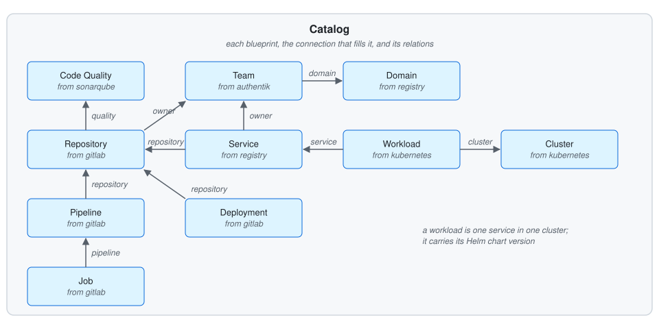
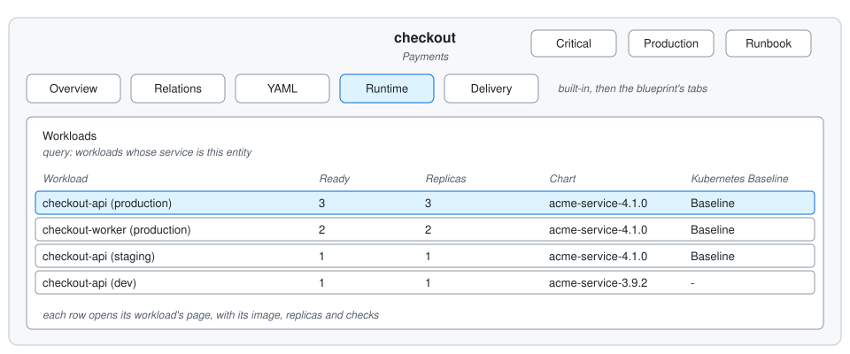
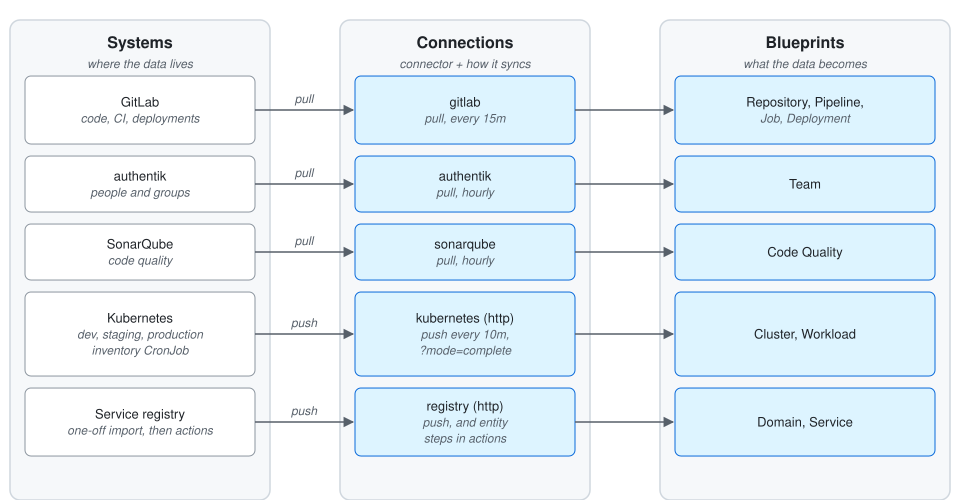
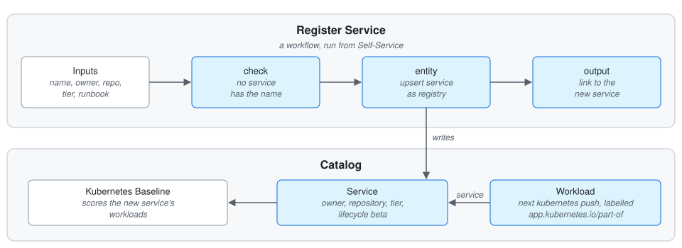
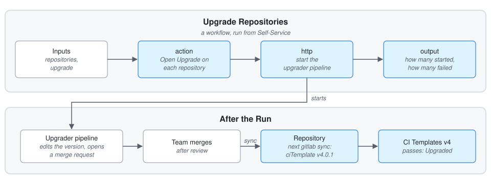

# Growing

A portal for development and delivery: services that outgrow their repositories, Kubernetes clusters for dev, staging and production, CI and code quality, and the upgrades every team has to make, all in the one portal that already holds the catalog. It builds on [Getting Started](getting-started.md).

## The Need

- One repository can hold several services, and one service runs in three clusters, so a repository no longer stands for a service.
- Ownership changes with every reorganization, and the spreadsheet that tracks it is always behind.
- Every repository uses shared CI templates and a shared Helm chart, and each new major version means chasing every team to upgrade.
- Nobody can see which pipelines are slow or flaky, or which code is getting worse, until a team complains.

## The Systems

- **GitLab** holds the code, and runs CI: pipelines, their jobs, and deployments to each environment. Every repository's CI includes the shared CI templates, at a version it pins.
- **authentik** holds people and groups. Teams are authentik groups, and people sign in to the portal with it, so `$me.groups` holds their team names, such as Payments.
- **SonarQube** scans the code on every merge, for coverage and a quality gate.
- **Kubernetes** runs the services, in a dev, a staging and a production cluster. Each service deploys with the shared Helm chart, acme-service, whose version shows on every workload.

## The Catalog



- **Service**: something a team runs and is paged for, such as checkout. It's the hub. No system knows every service, so the portal holds them itself, in a registry connection that actions write to.
- **Domain**: a group of teams, such as commerce. Held in the registry too.
- **Team**: an authentik group marked as a team, with its members, chat channel and domain.
- **Repository**: as in [Getting Started](getting-started.md#repository), plus its code quality and the CI templates version it uses.
- **Code Quality**: one SonarQube project. A separate blueprint, since SonarQube names projects its own way; the repository links to it and reads its results.
- **Pipeline** and **Job**: CI runs, kept for a few weeks, to see what's slow, failing or flaky.
- **Deployment**: one deploy to an environment, for how often teams ship.
- **Cluster** and **Workload**: a workload is one service in one cluster, such as checkout-api in production. It's where image, replicas, limits and Helm chart version live.

### Team and Service

<details>
<summary>Team blueprint</summary>

```yaml
kind: Blueprint
metadata:
  identifier: team
  title: Team
  icon: users
spec:
  properties:
    domain:
      relation: domain
    members:
      title: Members
      type: array
    channel:
      title: Chat Channel
      type: string
  sources:
    - connection: authentik
      resource: groups
      filter: .attributes.team == true
      entity:
        identifier: .name | ascii_downcase    # "Payments" becomes payments, its GitLab group's path
        title: .name
        properties:
          domain: .attributes.domain
          members: ._members
          channel: .attributes.channel
```

</details>

<details>
<summary>Service blueprint</summary>

```yaml
kind: Blueprint
metadata:
  identifier: service
  title: Service
  icon: server
spec:
  properties:
    owner:
      relation: team
      required: true
      display:
        filter: true
    repository:
      relation: repository
    tier:
      title: Tier
      type: string
      enum:
        - critical
        - standard
        - internal
      display:
        as: badge
        colors:
          critical: red
          standard: blue
          internal: gray
    lifecycle:
      title: Lifecycle
      type: string
      enum:
        - beta
        - production
        - deprecated
    runbook:
      title: Runbook
      type: string
      format: uri
    dashboard:
      title: Monitoring
      type: string
      format: uri
    domain:
      title: Domain
      lookup: owner.domain.title
  sources:
    - connection: registry
      resource: services
      entity:
        identifier: .name
        title: .name
        properties:
          owner: .team
          repository: .repository
          tier: .tier
          lifecycle: .lifecycle
          runbook: .runbook
          dashboard: .dashboard
```

</details>

- `required: true` turns away a service without an owner, from the import or an action.
- `domain` reads through the owner: moving a team moves its services.

### Repository and Code Quality

SonarQube keys follow the project path (`acme_payments_api` for `acme/payments/api`), so the repository can name its SonarQube project and look up its results. The CI templates version comes from GitLab's view of the repository's CI config, which lists every include and the ref it pins.

<details>
<summary>Repository: what's added</summary>

```yaml
spec:
  properties:  # added to Getting Started's
    quality:
      relation: quality
    coverage:
      title: Coverage
      lookup: quality.coverage
    qualityGate:
      title: Quality Gate
      lookup: quality.qualityGate
    ciTemplate:
      title: CI Templates
      type: string
    ciTemplateMajor:
      title: CI Templates Major
      type: integer
      compute: '[(.ciTemplate // "") | capture("^v(?<major>[0-9]+)").major | tonumber][0]'
    ciUpgrade:
      type: scorecard
      scorecard: ci-templates-v4
  sources:
    - connection: gitlab
      resource: projects
      entity:
        identifier: .path_with_namespace
        title: .name
        properties:  # added to Getting Started's
          quality: .path_with_namespace | gsub("/"; "_")
          ciTemplate: '[._ciConfig.includes[]? | select(.extra.project == "acme/platform/ci-templates") | .extra.ref][0]'   # v3.8.0
```

</details>

<details>
<summary>Code Quality blueprint</summary>

```yaml
kind: Blueprint
metadata:
  identifier: quality
  title: Code Quality
  icon: gauge
spec:
  properties:
    coverage:
      title: Coverage
      type: number
      display:
        unit: "%"
    qualityGate:
      title: Quality Gate
      type: string
      display:
        as: badge
        colors:
          OK: green
          ERROR: red
  sources:
    - connection: sonarqube
      resource: projects
      entity:
        identifier: .key
        title: .name
        properties:
          coverage: ._measures.coverage
          qualityGate: ._qualityGate.status
```

</details>

- `ciTemplateMajor` is computed from `ciTemplate` ("v3.8.0" gives 3), so a scorecard and an action's scope can compare it as a number.

### Pipeline, Job and Deployment

These grow with every sync, so each keeps rows by date with [retention](../syncing.md#keeping-history-in-check), which needs `mode: upsert`.

<details>
<summary>Pipeline, Job and Deployment blueprints</summary>

```yaml
kind: Blueprint
metadata:
  identifier: pipeline
  title: Pipeline
  icon: workflow
spec:
  properties:
    repository:
      relation: repository
    ref:
      title: Ref
      type: string
    status:
      title: Status
      type: string
      display:
        as: badge
        colors:
          success: green
          failed: red
    durationSeconds:
      title: Duration
      type: number
      display:
        unit: s
    triggeredAt:
      title: Triggered
      type: string
      format: date-time
    team:
      title: Team
      lookup: repository.owner.title
  retention:
    by: triggeredAt
    keep: 30d
    rules:
      - filter:
          property: ref
          op: eq
          value: main
        keep: 90d
  sources:
    - connection: gitlab
      resource: pipelines
      mode: upsert
      entity:
        identifier: .id | tostring
        title: ._project + " " + .ref
        properties:
          repository: ._project
          ref: .ref
          status: .status
          durationSeconds: .duration
          triggeredAt: .created_at
```

```yaml
kind: Blueprint
metadata:
  identifier: job
  title: Job
  icon: square-terminal
spec:
  properties:
    pipeline:
      relation: pipeline
    repository:
      relation: repository
    stage:
      title: Stage
      type: string
    status:
      title: Status
      type: string
    flaky:
      title: Flaky
      type: boolean
    waitSeconds:
      title: Wait
      type: number
      display:
        unit: s
    finishedAt:
      title: Finished
      type: string
      format: date-time
    team:
      title: Team
      lookup: repository.owner.title
  retention:
    by: finishedAt
    keep: 14d
  sources:
    - connection: gitlab
      resource: jobs
      mode: upsert
      entity:
        identifier: .id | tostring
        title: .name
        properties:
          pipeline: .pipeline.id | tostring
          repository: ._project
          stage: .stage
          status: .status
          flaky: ._flaky
          waitSeconds: ._waitSeconds
          finishedAt: .finished_at // .created_at
```

```yaml
kind: Blueprint
metadata:
  identifier: deployment
  title: Deployment
  icon: rocket
spec:
  properties:
    repository:
      relation: repository
    environment:
      title: Environment
      type: string
    status:
      title: Status
      type: string
    deployedAt:
      title: Deployed
      type: string
      format: date-time
  retention:
    by: deployedAt
    keep: 90d
  sources:
    - connection: gitlab
      resource: deployments
      mode: upsert
      entity:
        identifier: .id | tostring
        title: ._project + " " + .environment.name
        properties:
          repository: ._project
          environment: .environment.name
          status: .status
          deployedAt: .created_at
```

</details>

- `_flaky` and `_waitSeconds` are extras the GitLab connector works out per job: whether it passed only on a retry, and how long it waited for a runner.
- Main-branch pipelines stay 90 days, the rest 30.

### Cluster and Workload

<details>
<summary>Workload and Cluster blueprints</summary>

```yaml
kind: Blueprint
metadata:
  identifier: workload
  title: Workload
  icon: box
spec:
  properties:
    service:
      relation: service
    cluster:
      relation: cluster
      display:
        filter: true
    namespace:
      title: Namespace
      type: string
    image:
      title: Image
      type: string
    replicas:
      title: Replicas
      type: integer
    ready:
      title: Ready
      type: integer
    limitsSet:
      title: Memory Limits Set
      type: boolean
    chart:
      title: Chart
      type: string
    chartMajor:
      title: Chart Major
      type: integer
      compute: '[(.chart // "") | capture("^acme-service-(?<major>[0-9]+)[.]").major | tonumber][0]'
    team:
      title: Team
      lookup: service.owner.title
    baseline:
      type: scorecard
      scorecard: kubernetes-baseline
  sources:
    - connection: kubernetes
      resource: workloads
      entity:
        identifier: .cluster + "/" + .metadata.namespace + "/" + .metadata.name
        title: .metadata.name + " (" + .cluster + ")"  # checkout-api (production)
        properties:
          service: .metadata.labels["app.kubernetes.io/part-of"]
          cluster: .cluster
          namespace: .metadata.namespace
          image: .spec.template.spec.containers[0].image
          replicas: .spec.replicas
          ready: .status.readyReplicas // 0
          limitsSet: '[.spec.template.spec.containers[].resources.limits.memory] | all'
          chart: .metadata.labels["helm.sh/chart"]   # acme-service-4.1.0
```

```yaml
kind: Blueprint
metadata:
  identifier: cluster
  title: Cluster
  icon: network
spec:
  properties:
    version:
      title: Kubernetes Version
      type: string
  sources:
    - connection: kubernetes
      resource: clusters
      entity:
        identifier: .name
        title: .name
        properties:
          version: .version
```

</details>

- The `app.kubernetes.io/part-of` label names the service; a typo leaves the relation pointing at nothing, which the baseline scorecard catches.
- Helm sets the `helm.sh/chart` label to the chart's name and version, so the workload knows which acme-service release it runs.

### What People See



- **Service page**: the owner, tier and lifecycle beside the title; a Runtime tab with its workloads in every cluster, their chart and baseline; a Delivery tab with its pipelines and deploys.
- **Repository page**: as in Getting Started, with coverage, quality gate and CI templates version on the overview. Open Upgrade runs from here.
- **Workload page**: image, replicas, chart and its baseline checks.
- **Cluster page**: its Kubernetes version, and the Relations tab lists every workload on it.

<details>
<summary>Service page: header, sections, Runtime and Delivery tabs</summary>

```yaml
spec:
  catalog:
    columns:
      - owner
      - domain
      - tier
      - lifecycle
  entity:
    header:
      subtitle: owner
      badges:
        - tier
        - lifecycle
      link: runbook
    sections:
      - title: Ownership
        properties:
          - owner
          - domain
          - repository
      - title: Operations
        properties:
          - tier
          - lifecycle
          - runbook
          - dashboard
    queries:
      workloads:
        blueprint: workload
        filter:
          property: service
          op: eq
          value: $entity
      pipelines:
        blueprint: pipeline
        filter:
          and:
            - property: repository
              op: eq
              value: $entity.repository
            - property: ref
              op: eq
              value: main
      deploys:
        blueprint: deployment
        filter:
          property: repository
          op: eq
          value: $entity.repository
    tabs:
      runtime:
        title: Runtime
        widgets:
          list:
            type: table
            title: Workloads
            query: workloads
            columns:
              - path: ready
              - path: replicas
              - path: chart
              - path: baseline
      delivery:
        title: Delivery
        when:
          property: repository
          op: exists
        widgets:
          passing:
            type: trend
            title: Main Pipelines Passing
            query: pipelines
            date: triggeredAt
            measure:
              share:
                property: status
                op: eq
                value: success
          duration:
            type: trend
            title: Main Pipeline P95 Duration
            query: pipelines
            date: triggeredAt
            measure:
              p95: durationSeconds
          deploys:
            type: trend
            title: Production Deploys
            query: deploys
            date: deployedAt
            measure:
              filter:
                property: environment
                op: eq
                value: production
```

</details>

## Getting Data In



- **GitLab** as in Getting Started, now also reading `pipelines`, `jobs` and `deployments`.
- **authentik** and **SonarQube**, hourly, as on their [connector pages](../connectors/README.md).

### Kubernetes: One Push for Three Clusters

A CronJob in the production cluster reads all three clusters, through a read-only kubeconfig context for each, and pushes them as one body. One connection then holds every cluster, and a complete push deletes whatever any cluster stopped running.

<details>
<summary>Kubernetes connection</summary>

```yaml
kind: Connection
metadata:
  identifier: kubernetes
  title: Kubernetes
spec:
  connector:
    type: http
    config:
      resources:
        clusters:
          push:
            items: '.body.clusters[] | {name: .cluster, version: .version}'
        workloads:
          push:
            items: '.body.clusters[] | .cluster as $c | .items[] | select(.kind == "Deployment" or .kind == "StatefulSet") | .cluster = $c'
```

</details>

<details>
<summary>Inventory CronJob script, every 10 minutes</summary>

```sh
set -euo pipefail
for c in dev staging production; do
  v=$(kubectl --context "$c" version -o json | jq -r .serverVersion.gitVersion)
  kubectl --context "$c" get deployments,statefulsets -A -o json \
    | jq --arg c "$c" --arg v "$v" '{cluster: $c, version: $v, items: [.items[] | del(.metadata.managedFields)]}' > "/tmp/$c.json"
done
jq -s '{clusters: .}' /tmp/*.json \
  | curl -fsS -X POST "$PORTAL_URL/api/ingest/kubernetes?mode=complete" \
      -H "Authorization: Bearer $INGEST_TOKEN" -H "Content-Type: application/json" --data @-
```

</details>

- `set -e` stops the job when any cluster can't be read, so a complete push never leaves a cluster out and deletes its workloads.
- **Connections › Kubernetes › Push** creates the token, kept in the cluster as a Secret.

### The Registry: Services Held in the Portal

No system knew every service, so the portal holds them. The registry connection only receives.

<details>
<summary>Registry connection</summary>

```yaml
kind: Connection
metadata:
  identifier: registry
  title: Service Registry
spec:
  connector:
    type: http
    config:
      resources:
        domains:
          push:
            items: .body.domains[]
        services:
          push:
            items: .body.services[]
```

</details>

- The first load is one push of the old spreadsheet, as JSON, with a `domains` list and a `services` list.
- After that, actions write services through `entity` steps. The registry doesn't pull, so only pushes and actions change services.

## Self-Service

### Register a Service

Replaces "please add my service to the spreadsheet". The registered service is in the catalog when the run ends.



<details>
<summary>Register Service workflow</summary>

```yaml
kind: Workflow
metadata:
  identifier: register-service
  title: Register Service
spec:
  group: Create
  run:
    roles:
      - member
  inputs:
    name:
      title: Name
      type: string
      required: true
      pattern: "^[a-z][a-z0-9-]{2,40}$"
    team:
      title: Owner
      relation: team
      required: true
    repository:
      title: Repository
      relation: repository
      required: true
    tier:
      title: Tier
      type: string
      enum:
        - critical
        - standard
        - internal
      required: true
    runbook:
      title: Runbook
      type: string
      format: uri
  steps:
    - check:
        blueprint: service
        filter:
          property: identifier
          op: eq
          value: $input.name
        expect:
          count: 0
        message: That name is taken; pick another, or transfer the existing service.
    - id: service
      entity:
        operation: upsert
        connection: registry
        blueprint: service
        identifier: $input.name
        title: $input.name
        properties:
          owner: $input.team
          repository: $input.repository
          tier: $input.tier
          lifecycle: beta
          runbook: $input.runbook
    - output:
        summary: Registered {{ $input.name }}. Label its workloads app.kubernetes.io/part-of={{ $input.name }} to link them.
        links:
          Service: $step.service.url
```

</details>

- Starting from a template instead? Add the [Scaffold Service](getting-started.md#scaffold-a-service) steps before the `entity` step, and pass the new repository.

### Transfer a Service

Replaces ownership tickets after a reorganization. The current owner hands over; `upsert` changes only `owner` and keeps the rest.

<details>
<summary>Transfer action</summary>

```yaml
kind: Action
metadata:
  identifier: transfer-service
  title: Transfer
spec:
  blueprint: service
  group: Manage
  run:
    filter:
      property: owner.title
      op: in
      values: $me.groups
  inputs:
    team:
      title: New Owner
      relation: team
      required: true
  steps:
    - entity:
        operation: upsert
        connection: registry
        blueprint: service
        identifier: $entity
        properties:
          owner: $input.team
    - output:
        summary: "{{ $entity.title }} now belongs to {{ $input.team }}."
```

</details>

- Other fields change the same way, one small action each, such as Set Runbook with a required `runbook` input. Required inputs mean a run never writes an empty value over a good one.

### Reassign Services

Replaces a reorganization's worth of ownership tickets. It runs Transfer on each service picked, so each transfer still checks that the person owns that service.

<details>
<summary>Reassign Services workflow</summary>

```yaml
kind: Workflow
metadata:
  identifier: reassign-services
  title: Reassign Services
spec:
  group: Manage
  run:
    roles:
      - member
  inputs:
    services:
      title: Services
      relation: service
      many: true
      required: true
    team:
      title: New Owner
      relation: team
      required: true
  steps:
    - id: transfer
      action:
        name: transfer-service
        entities: $input.services
        inputs:
          team: $input.team
        maxFailures: 5
    - output:
        summary: "{{ $step.transfer.succeeded }} moved to {{ $input.team }}, {{ $step.transfer.failed }} refused."
```

</details>

- A service the person doesn't own is refused and counts as failed; past 5, the step fails, and the run page shows which.
- Up to 100 services per run; each transfer is its own run, linked from this one.

### Upgrade a Repository

Replaces an upgrade campaign of tickets and reminders. An upgrader pipeline, kept beside the shared templates, knows how to make each upgrade: it edits the version, pushes a branch and opens a merge request. The portal puts it one click from every repository, next to the checks it fixes.

<details>
<summary>Open Upgrade action</summary>

```yaml
kind: Action
metadata:
  identifier: open-upgrade
  title: Open Upgrade
spec:
  blueprint: repository
  group: Upgrade
  scope:
    not:
      property: archived
      op: eq
      value: true
  run:
    filter:
      property: owner.title
      op: in
      values: $me.groups
  inputs:
    upgrade:
      title: Upgrade
      type: string
      enum:
        - ci-templates-v4
        - acme-service-chart-4
      required: true
  steps:
    - id: pipeline
      http:
        method: POST
        url: https://gitlab.acme.example/api/v4/projects/acme%2Fplatform%2Fupgrader/pipeline
        headers:
          PRIVATE-TOKEN:
            env: GP_SECRET_GITLAB_OPS_TOKEN
        body:
          ref: main
          variables:
            - key: PROJECT_ID
              value: "{{ $entity.projectId }}"
            - key: UPGRADE
              value: $input.upgrade
            - key: ASSIGNEE
              value: $me.email
        output:
          url: .body.web_url
    - output:
        summary: The upgrader opens a merge request in {{ $entity.title }} within a few minutes, assigned to {{ $me.name }}.
        links:
          Upgrader Pipeline: $step.pipeline.url
```

</details>

### Upgrade Many Repositories

The same, across many repositories at once, such as every one of a team's repositories still on CI templates v3.



<details>
<summary>Upgrade Repositories workflow</summary>

```yaml
kind: Workflow
metadata:
  identifier: upgrade-repositories
  title: Upgrade Repositories
spec:
  group: Upgrade
  run:
    roles:
      - member
  inputs:
    repositories:
      title: Repositories
      relation: repository
      many: true
      required: true
    upgrade:
      title: Upgrade
      type: string
      enum:
        - ci-templates-v4
        - acme-service-chart-4
      required: true
  steps:
    - id: open
      action:
        name: open-upgrade
        entities: $input.repositories
        inputs:
          upgrade: $input.upgrade
        maxFailures: 10
    - output:
        summary: "{{ $step.open.succeeded }} upgrades started, {{ $step.open.failed }} refused."
```

</details>

- Each run checks Open Upgrade's run filter, so people upgrade only their own team's repositories.
- Once a merge request is merged, the next GitLab sync reads the new CI templates version, and the repository passes the upgrade scorecard. The Helm chart shows on workloads after the next deploy and cluster push.

### Decommission a Service

Replaces the decommissioning checklist. The owning team deprecates a service once nothing runs it in production; a teammate signs off.

<details>
<summary>Decommission action</summary>

```yaml
kind: Action
metadata:
  identifier: decommission-service
  title: Decommission
spec:
  blueprint: service
  group: Manage
  scope:
    not:
      property: lifecycle
      op: eq
      value: deprecated
  run:
    filter:
      property: owner.title
      op: in
      values: $me.groups
  inputs:
    reason:
      title: Reason
      type: string
      required: true
  steps:
    - check:
        blueprint: workload
        filter:
          and:
            - property: service
              op: eq
              value: $entity
            - property: cluster
              op: eq
              value: production
        expect:
          count: 0
        message: Production workloads still run this service; scale them away first. Its Runtime tab lists them.
    - approval:
        approvers:
          filter:  # the owning team
            property: owner.title
            op: in
            values: $me.groups
        require: 1
        timeout: 72h
        message: "{{ $me.name }} wants to decommission {{ $entity.title }}."
        review:
          - title: Reason
            markdown: $input.reason
    - entity:
        operation: upsert
        connection: registry
        blueprint: service
        identifier: $entity
        properties:
          lifecycle: deprecated
    - output:
        summary: "{{ $entity.title }} is deprecated. Next: delete its dev and staging workloads, and the repository's GitLab environments."
```

</details>

- The `check` counts workloads from the latest cluster push, so it reflects what runs now.

## Scorecards

- **Kubernetes Baseline**, on workloads: linked to a service, memory limits set, two replicas in production, and the current Helm chart.
- **CI Templates v4**, on repositories that use the shared templates: one check over the computed `ciTemplateMajor`. Every repository is done or not, and the scorecard widget shows how many are left.

<details>
<summary>Kubernetes Baseline scorecard</summary>

```yaml
kind: Scorecard
metadata:
  identifier: kubernetes-baseline
  title: Kubernetes Baseline
spec:
  blueprint: workload
  tiers:
    - name: baseline
      title: Baseline
      color: green
      criteria:
        linked:
          title: Linked to Its Service
          check:
            property: service.title
            op: exists
          fix: Set the app.kubernetes.io/part-of label to the service's name.
        limits:
          title: Memory Limits Set
          check:
            property: limitsSet
            op: eq
            value: true
        replicas:
          title: Two or More Replicas
          when:
            property: cluster
            op: eq
            value: production
          check:
            property: replicas
            op: gte
            value: 2
        chart:
          title: On acme-service Chart 4
          when:
            property: chart
            op: exists
          check:
            property: chartMajor
            op: gte
            value: 4
          fix: Run Open Upgrade on the service's repository with acme-service-chart-4.
```

</details>

<details>
<summary>CI Templates v4 scorecard</summary>

```yaml
kind: Scorecard
metadata:
  identifier: ci-templates-v4
  title: CI Templates v4
spec:
  blueprint: repository
  filter:
    and:
      - property: ciTemplate
        op: exists
      - not:
          property: archived
          op: eq
          value: true
  tiers:
    - name: upgraded
      title: Upgraded
      color: green
      criteria:
        onV4:
          title: On CI Templates v4 or Later
          check:
            property: ciTemplateMajor
            op: gte
            value: 4
          fix: Run Open Upgrade from this page with ci-templates-v4.
```

</details>

## Dashboards

- **My Team**: workloads below baseline, repositories still on old CI templates, how often main pipelines pass, this week's flaky jobs, and the team's self-service.
- **Engineering**, for leads: CI by team, both upgrades, and production deploys per day.

<details>
<summary>My Team dashboard</summary>

```yaml
spec:
  inputs:
    team:
      type: relation
      relation: team
      multiple: true
      default:
        query:
          blueprint: team
          filter:
            property: title
            op: in
            values: $me.groups
  queries:
    belowBaseline:
      blueprint: workload
      filter:
        and:
          - property: service.owner
            op: in
            values: $input.team
          - property: baseline.failed
            op: gt
            value: 0
    oldTemplates:
      blueprint: repository
      filter:
        and:
          - property: owner
            op: in
            values: $input.team
          - property: ciUpgrade.failed
            op: gt
            value: 0
    pipelines:
      blueprint: pipeline
      filter:
        and:
          - property: repository.owner
            op: in
            values: $input.team
          - property: ref
            op: eq
            value: main
          - property: triggeredAt
            op: within
            value: 7d
    flaky:
      blueprint: job
      filter:
        and:
          - property: repository.owner
            op: in
            values: $input.team
          - property: flaky
            op: eq
            value: true
          - property: finishedAt
            op: within
            value: 7d
  widgets:
    belowBaseline:
      type: stat
      title: Workloads Below Baseline
      value:
        query: belowBaseline
      link:
        query: belowBaseline
    oldTemplates:
      type: stat
      title: On Old CI Templates
      value:
        query: oldTemplates
      link:
        query: oldTemplates
    passing:
      type: stat
      title: Main Pipelines Passing, 7 Days
      value:
        query: pipelines
        share:
          property: status
          op: eq
          value: success
    run:
      type: actions
      title: Self-Service
      workflows:
        - register-service
        - upgrade-repositories
      width: 3
    flaky:
      type: table
      title: Flaky Jobs This Week
      query: flaky
      columns:
        - path: repository
        - path: stage
        - path: finishedAt
      sort: -finishedAt
```

</details>

<details>
<summary>Engineering dashboard</summary>

```yaml
spec:
  visibility:
    groups:
      - Engineering Leads
  queries:
    mainPipelines:
      blueprint: pipeline
      filter:
        and:
          - property: ref
            op: eq
            value: main
          - property: triggeredAt
            op: within
            value: 30d
    deploys:
      blueprint: deployment
      filter:
        and:
          - property: environment
            op: eq
            value: production
          - property: status
            op: eq
            value: success
  widgets:
    templates:
      type: scorecard
      title: CI Templates v4
      scorecard: ci-templates-v4
    baseline:
      type: scorecard
      title: Kubernetes Baseline
      scorecard: kubernetes-baseline
    ciByTeam:
      type: matrix
      title: Main Pipelines by Team, Last 30 Days
      query: mainPipelines
      groupBy: team
      measures:
        - title: Pipelines
        - title: Passing
          share:
            property: status
            op: eq
            value: success
        - title: P50 Duration
          p50: durationSeconds
        - title: P95 Duration
          p95: durationSeconds
    deploys:
      type: trend
      title: Production Deploys Per Day
      query: deploys
      date: deployedAt
```

</details>

## Rollout

1. **Registry and ownership**: import the spreadsheet, then turn on Register and Transfer, so the catalog stays right without a spreadsheet.
2. **Runtime**: the cluster push, linking workloads to services, with Kubernetes Baseline pointing at fixes in one file.
3. **Delivery**: pipelines, jobs, deployments and SonarQube, so the Delivery tab and dashboards show how teams ship.
4. **Upgrades**: the CI Templates v4 scorecard together with Open Upgrade and Upgrade Repositories, so every failing check has its fix one click away.
5. **Reorganizations**: Reassign Services and Decommission, once teams rely on the registry.
