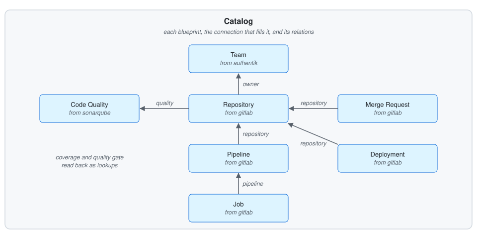
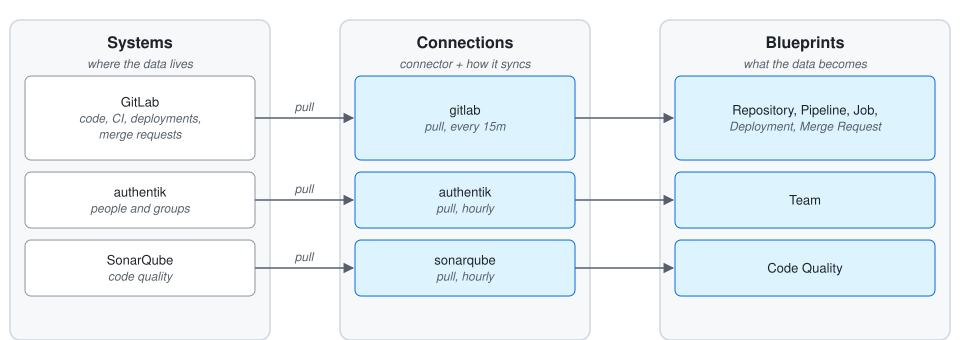
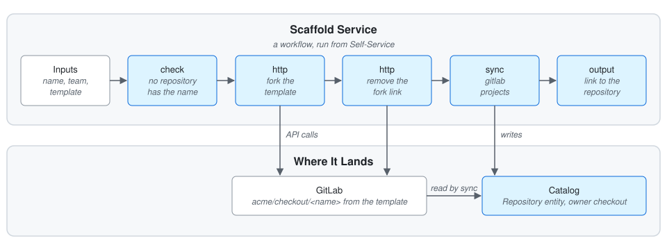
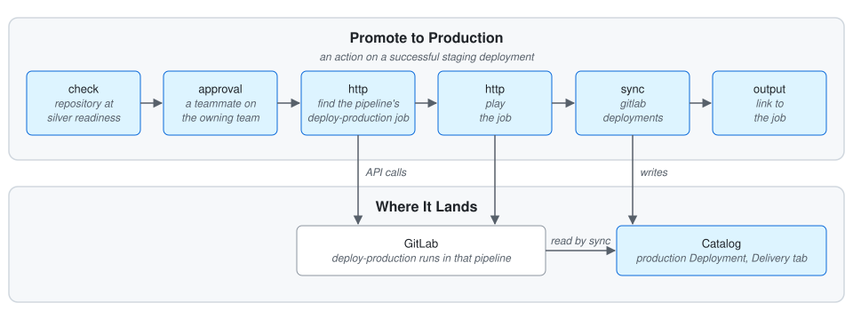

# Case Study

Acme's teams, such as Payments and Checkout, keep their code in GitLab, sign in with authentik and scan code with SonarQube. Their portal puts those three in one place: developers see their team's repositories and ask for access, start services and promote releases without waiting on anyone with admin rights; leads see readiness and delivery by team, and can open the repositories behind every number.

## The Need

- See which team owns each repository.
- Let people request access to repositories themselves.
- Start new services from a template.
- Promote a release to production, with the owning team's approval.
- See pipelines, merge requests and code quality by team.

## What It's Like

### A Developer

- A developer on Payments opens Home. My Team shows the team's failing CI, merge requests waiting more than two days, production deploys this week and flaky jobs. Each number opens the list behind it.
- The acme/payments/api page shows its owner, CI status and readiness tier beside the title. On the overview: coverage, quality gate and open critical vulnerabilities. The Delivery tab has its main-branch pass rate, pipeline duration, production deploys and recent staging deploys; the Work tab, its open merge requests.
- To read acme/checkout/web, they run **Request Access** on its page, with a reason and an end date. Someone on Checkout approves, and GitLab grants Developer access until that date.
- Built with [the catalog](#the-catalog), [My Team](#dashboards) and [Request Repository Access](#request-repository-access).

### Starting a Service

- A developer on Checkout runs **Scaffold Service** from Self-Service: a name, a team and a template.
- The run checks the name is free, creates the repository in acme/checkout from the template, and reads it back from GitLab. It ends with a link to the new repository, already owned by Checkout and listed on the team's page.
- Built with [Scaffold a Service](#scaffold-a-service).

### Shipping to Production

- On acme/payments/api, the Delivery tab lists recent staging deploys. A developer opens the latest one and runs **Promote to Production**.
- The portal checks that the repository is at silver in Production Readiness. If it isn't, the run stops and says where the failing checks are.
- A teammate on Payments sees the ref, commit and pipeline, and approves.
- The portal plays that pipeline's `deploy-production` job in GitLab and links to it. The production deployment shows on the Delivery tab when the run ends.
- For a release across several services, **Promote Release** does the same for several staging deploys at once, each team approving its own.
- Built with [Promote to Production](#promote-to-production) and [Production Readiness](#scorecard).

### A Lead

- The Engineering dashboard shows Production Readiness across repositories, readiness and median coverage by team, main-branch pipelines by team, and production deploys per day.
- A click on a team's share opens the repositories that don't meet it. Each repository's page lists the checks it fails, with how to fix each.
- Built with [the Engineering dashboard](#dashboards) and [Production Readiness](#scorecard).

## How It's Built

### The Systems

- **GitLab** holds the code and the organization: each team is a GitLab group, and its projects sit inside. It also runs CI (pipelines and their jobs), deploys to each environment, and holds every merge request. Each repository's pipeline deploys to staging on its own, and has a manual `deploy-production` job that someone plays to promote that build to production.
- **authentik** holds people and groups. Teams are authentik groups named like their GitLab group, such as Payments for acme/payments. People sign in to the portal with authentik, so `$me.groups` holds their team names.
- **SonarQube** scans the code on every merge, for coverage and a quality gate. Its project keys follow the GitLab path, such as `acme_payments_api` for `acme/payments/api`.

### The Catalog



- **Team**: an authentik group marked as a team, with its members and chat channel. It exists so everything else has an owner.
- **Repository**: a GitLab project, and the hub. One repository is one deployable service, so there's no separate service blueprint. Its owner is the team whose group holds it.
- **Code Quality**: one SonarQube project. A separate blueprint, since SonarQube names projects its own way; the repository links to it and reads its coverage and quality gate.
- **Pipeline** and **Job**: CI runs, kept for a few weeks, to see what's slow, failing or flaky.
- **Deployment**: one deploy to an environment, for how often teams ship and what still runs. A successful staging deployment is what gets promoted to production.
- **Merge Request**: one GitLab merge request, with its author and reviewers, so a team sees what's waiting.

#### Team

<details>
<summary>Team blueprint</summary>

```yaml
kind: Blueprint
metadata:
  identifier: team
  title: Team
  icon: users
spec:
  properties:
    members:
      title: Members
      type: array
    channel:
      title: Chat Channel
      type: string
  entity:
    queries:
      repositories:
        blueprint: repository
        filter:
          property: owner
          op: eq
          value: $entity
    tabs:
      repositories:
        title: Repositories
        widgets:
          list:
            type: table
            title: Repositories
            query: repositories
            columns:
              - path: ci
              - path: readiness
  sources:
    - connection: authentik
      resource: groups
      filter: .attributes.team == true
      entity:
        identifier: .name | ascii_downcase  # "Payments" becomes payments, its GitLab group's path
        title: .name
        properties:
          members: ._members
          channel: .attributes.channel      # set by authentik admins, such as "#payments"
```

</details>

#### Repository and Code Quality

The project's group gives the owner.

<details>
<summary>Repository blueprint</summary>

```yaml
kind: Blueprint
metadata:
  identifier: repository
  title: Repository
  icon: git-branch
spec:
  properties:
    owner:
      relation: team
      display:
        filter: true
    quality:
      relation: quality
    url:
      title: GitLab
      type: string
      format: uri
    projectId:
      title: Project ID
      type: integer
      display:
        hidden: true
    topics:
      title: Topics
      type: array
    archived:
      title: Archived
      type: boolean
    ci:
      title: CI
      type: string
      display:
        as: badge
        colors:
          success: green
          failed: red
    defaultBranchProtected:
      title: Default Branch Protected
      type: boolean
    hasRunbook:
      title: Runbook
      type: boolean
    criticalVulnerabilities:
      title: Critical Vulnerabilities
      type: integer
    lastActivityAt:
      title: Last Activity
      type: string
      format: date-time
    coverage:
      title: Coverage
      lookup: quality.coverage
    qualityGate:
      title: Quality Gate
      lookup: quality.qualityGate
    readiness:
      type: scorecard
      scorecard: readiness
  sources:
    - connection: gitlab
      resource: projects
      entity:
        identifier: .path_with_namespace
        title: .name
        properties:
          owner: .namespace.path
          quality: .path_with_namespace | gsub("/"; "_")
          url: .web_url
          projectId: .id
          topics: .topics
          archived: .archived
          ci: ._latestPipeline.status
          defaultBranchProtected: ._defaultBranch.protected
          hasRunbook: '(._files // []) | any(. == "RUNBOOK.md")'
          criticalVulnerabilities: ._vulnerabilities.critical
          lastActivityAt: .last_activity_at
```

</details>

<details>
<summary>Code Quality blueprint</summary>

```yaml
kind: Blueprint
metadata:
  identifier: quality
  title: Code Quality
  icon: gauge
spec:
  properties:
    coverage:
      title: Coverage
      type: number
      display:
        unit: "%"
    qualityGate:
      title: Quality Gate
      type: string
      display:
        as: badge
        colors:
          OK: green
          ERROR: red
  sources:
    - connection: sonarqube
      resource: projects
      entity:
        identifier: .key
        title: .name
        properties:
          coverage: ._measures.coverage
          qualityGate: ._qualityGate.status
```

</details>

- `projectId` is hidden from pages, but actions use it to call the GitLab API.
- Libraries carry the GitLab topic `library`; the scorecard and dashboards leave them out.
- The GitLab connection leaves `excludeArchived` off, so archived projects stay in the catalog, marked `archived`.

#### Pipeline, Job, Deployment and Merge Request

These grow with every sync, so each keeps rows by date with [retention](../syncing.md#keeping-history-in-check), which needs `mode: upsert`.

<details>
<summary>Pipeline and Job blueprints</summary>

```yaml
kind: Blueprint
metadata:
  identifier: pipeline
  title: Pipeline
  icon: workflow
spec:
  properties:
    repository:
      relation: repository
    ref:
      title: Ref
      type: string
    status:
      title: Status
      type: string
      display:
        as: badge
        colors:
          success: green
          failed: red
    durationSeconds:
      title: Duration
      type: number
      display:
        unit: s
    triggeredAt:
      title: Triggered
      type: string
      format: date-time
    team:
      title: Team
      lookup: repository.owner.title
  retention:
    by: triggeredAt
    keep: 30d
    rules:
      - filter:
          property: ref
          op: eq
          value: main
        keep: 90d
  sources:
    - connection: gitlab
      resource: pipelines
      mode: upsert
      entity:
        identifier: .id | tostring
        title: ._project + " " + .ref
        properties:
          repository: ._project
          ref: .ref
          status: .status
          durationSeconds: .duration
          triggeredAt: .created_at
```

```yaml
kind: Blueprint
metadata:
  identifier: job
  title: Job
  icon: square-terminal
spec:
  properties:
    pipeline:
      relation: pipeline
    repository:
      relation: repository
    stage:
      title: Stage
      type: string
    status:
      title: Status
      type: string
    flaky:
      title: Flaky
      type: boolean
    waitSeconds:
      title: Wait
      type: number
      display:
        unit: s
    finishedAt:
      title: Finished
      type: string
      format: date-time
  retention:
    by: finishedAt
    keep: 14d
  sources:
    - connection: gitlab
      resource: jobs
      mode: upsert
      entity:
        identifier: .id | tostring
        title: .name
        properties:
          pipeline: .pipeline.id | tostring
          repository: ._project
          stage: .stage
          status: .status
          flaky: ._flaky
          waitSeconds: ._waitSeconds
          finishedAt: .finished_at // .created_at
```

</details>

<details>
<summary>Deployment and Merge Request blueprints</summary>

```yaml
kind: Blueprint
metadata:
  identifier: deployment
  title: Deployment
  icon: rocket
spec:
  properties:
    repository:
      relation: repository
    environment:
      title: Environment
      type: string
    status:
      title: Status
      type: string
    deployedAt:
      title: Deployed
      type: string
      format: date-time
    ref:
      title: Ref
      type: string
    sha:
      title: Commit
      type: string
    pipelineId:
      title: Pipeline
      type: string
    projectId:
      title: Project ID
      lookup: repository.projectId
      display:
        hidden: true
    team:
      title: Team
      lookup: repository.owner.title
  retention:
    by: deployedAt
    keep: 90d
  sources:
    - connection: gitlab
      resource: deployments
      mode: upsert
      entity:
        identifier: .id | tostring
        title: ._project + " " + .environment.name
        properties:
          repository: ._project
          environment: .environment.name
          status: .status
          deployedAt: .created_at
          ref: .ref
          sha: .sha
          pipelineId: .deployable.pipeline.id | tostring
```

```yaml
kind: Blueprint
metadata:
  identifier: merge-request
  title: Merge Request
  icon: git-pull-request
spec:
  properties:
    repository:
      relation: repository
    state:
      title: State
      type: string
      enum:
        - opened
        - merged
        - closed
        - locked
      display:
        as: badge
        colors:
          opened: blue
          merged: green
          closed: gray
    draft:
      title: Draft
      type: boolean
    author:
      title: Author
      type: string
    reviewers:
      title: Reviewers
      type: array
    lastUpdated:
      title: Updated
      type: string
      format: date-time
    url:
      title: GitLab
      type: string
      format: uri
    team:
      title: Team
      lookup: repository.owner.title
  retention:
    by: lastUpdated
    keep: 30d
    rules:
      - filter:
          property: state
          op: eq
          value: opened
        keep: 520w
  sources:
    - connection: gitlab
      resource: merge_requests
      mode: upsert
      entity:
        identifier: ._project + "!" + (.iid | tostring)  # acme/payments/api!42
        title: .title
        properties:
          repository: ._project
          state: .state
          draft: .draft
          author: .author.username
          reviewers: '[.reviewers[]?.username]'
          lastUpdated: .updated_at
          url: .web_url
```

</details>

- `_flaky` and `_waitSeconds` are extras the GitLab connector works out per job: whether it passed only on a retry, and how long it waited for a runner.
- A deployment keeps the pipeline that made it, so Promote can find that pipeline's production job.
- Main-branch pipelines stay 90 days, the rest 30. Open merge requests stay; merged and closed ones go after 30 days.

#### What People See

- **Repository page**: owner, CI and readiness beside the title, health on the overview, a Delivery tab with its pipelines and deploys, and a Work tab with its open merge requests. Request Access runs from here.
- **Deployment page**: environment, ref, commit and pipeline. Promote runs from a successful staging deployment's page.
- **Team page**: a Repositories tab, from the team blueprint above.
- The built-in Relations tab lists what points at an entity, such as a repository's deployments.

<details>
<summary>Repository page: header, sections, Delivery and Work tabs</summary>

```yaml
spec:
  catalog:
    columns:
      - owner
      - ci
      - readiness
      - lastActivityAt
  entity:
    header:
      subtitle: owner
      badges:
        - ci
        - readiness
      link: url
    sections:
      - title: Health
        properties:
          - ci
          - defaultBranchProtected
          - criticalVulnerabilities
          - coverage
          - qualityGate
    queries:
      mainPipelines:
        blueprint: pipeline
        filter:
          and:
            - property: repository
              op: eq
              value: $entity
            - property: ref
              op: eq
              value: main
      deploys:
        blueprint: deployment
        filter:
          property: repository
          op: eq
          value: $entity
      staging:
        blueprint: deployment
        filter:
          and:
            - property: repository
              op: eq
              value: $entity
            - property: environment
              op: eq
              value: staging
            - property: status
              op: eq
              value: success
      openMergeRequests:
        blueprint: merge-request
        filter:
          and:
            - property: repository
              op: eq
              value: $entity
            - property: state
              op: eq
              value: opened
    tabs:
      delivery:
        title: Delivery
        widgets:
          passing:
            type: trend
            title: Main Pipelines Passing
            query: mainPipelines
            date: triggeredAt
            measure:
              share:
                property: status
                op: eq
                value: success
          duration:
            type: trend
            title: Main Pipeline P95 Duration
            query: mainPipelines
            date: triggeredAt
            measure:
              p95: durationSeconds
          deploys:
            type: trend
            title: Production Deploys
            query: deploys
            date: deployedAt
            measure:
              filter:
                property: environment
                op: eq
                value: production
          staging:
            type: table
            title: Staging Deploys
            query: staging
            columns:
              - path: ref
              - path: sha
              - path: deployedAt
            sort: -deployedAt
            limit: 5
      work:
        title: Work
        widgets:
          mergeRequests:
            type: table
            title: Open Merge Requests
            query: openMergeRequests
            columns:
              - path: author
              - path: reviewers
              - path: lastUpdated
            sort: lastUpdated
            rowLink:
              url: "{{ url }}"
```

</details>

### Getting Data In



- **GitLab**, every 15 minutes, reading `projects`, `pipelines`, `jobs`, `deployments` and `merge_requests`. With webhooks on, changes show [between syncs](../syncing.md#fresh-between-syncs).
- **authentik** and **SonarQube**, hourly.
- Each is set up as on its [connector page](../connectors/README.md); nothing else is needed.

<details>
<summary>GitLab connection</summary>

```yaml
kind: Connection
metadata:
  identifier: gitlab
  title: GitLab
spec:
  connector:
    type: gitlab
    config:
      url: https://gitlab.acme.example
      token:
        env: GP_SECRET_GITLAB_TOKEN
      groups:
        - acme
  sync:
    interval: 15m
```

</details>

### Self-Service

Each action here calls GitLab with the portal's token, so people don't need admin rights in GitLab to do it.

#### Request Repository Access

Anyone asks for Developer access to a repository. The owning team approves, and access expires on the date given.

<details>
<summary>Request Access action</summary>

```yaml
kind: Action
metadata:
  identifier: request-access
  title: Request Access
spec:
  blueprint: repository
  group: Access
  run:
    roles:
      - member
  inputs:
    until:
      title: Until
      type: string
      format: date
      required: true
    reason:
      title: Reason
      type: string
      required: true
  steps:
    - id: user
      http:
        method: GET
        url: https://gitlab.acme.example/api/v4/users?search={{ $me.email }}
        headers:
          PRIVATE-TOKEN:
            env: GP_SECRET_GITLAB_ADMIN_TOKEN
        output:
          id: .body[0].id
    - approval:
        approvers:
          filter:  # the owning team
            property: owner.title
            op: in
            values: $me.groups
        require: 1
        timeout: 72h
        message: "{{ $me.name }} asks for Developer access to {{ $entity.title }} until {{ $input.until }}."
        review:
          - title: Reason
            markdown: $input.reason
    - http:
        method: POST
        url: https://gitlab.acme.example/api/v4/projects/{{ $entity.projectId }}/members
        headers:
          PRIVATE-TOKEN:
            env: GP_SECRET_GITLAB_ADMIN_TOKEN
        body:
          user_id: $step.user.id
          access_level: 30
          expires_at: $input.until
    - output:
        summary: Developer access to {{ $entity.title }} until {{ $input.until }}.
```

</details>

- In `approvers`, `$me` is the approver: anyone in the owning team, but never the requester.
- One rejection ends the run; after 72 hours without enough approvals, it fails.

#### Scaffold a Service

Creates a repository from a template. A workflow, since it isn't tied to an existing entity.



<details>
<summary>Scaffold Service workflow</summary>

```yaml
kind: Workflow
metadata:
  identifier: scaffold-service
  title: Scaffold Service
spec:
  group: Create
  run:
    roles:
      - member
  inputs:
    name:
      title: Name
      type: string
      required: true
      pattern: "^[a-z][a-z0-9-]{2,30}$"
    team:
      title: Team
      relation: team
      required: true
    template:
      title: Template
      type: string
      enum:
        - go-service
        - node-service
      required: true
  steps:
    - check:
        blueprint: repository
        filter:
          property: title
          op: eq
          value: $input.name
        expect:
          count: 0
        message: A repository with that name exists; pick another name.
    - id: fork
      http:
        method: POST
        url: https://gitlab.acme.example/api/v4/projects/acme%2Ftemplates%2F{{ $input.template }}/fork
        headers:
          PRIVATE-TOKEN:
            env: GP_SECRET_GITLAB_ADMIN_TOKEN
        body:
          name: $input.name
          path: $input.name
          namespace_path: acme/{{ $input.team }}
        output:
          id: .body.id
          url: .body.web_url
    - http:
        method: DELETE
        url: https://gitlab.acme.example/api/v4/projects/{{ $step.fork.id }}/fork
        headers:
          PRIVATE-TOKEN:
            env: GP_SECRET_GITLAB_ADMIN_TOKEN
    - sync:
        connection: gitlab
        resources:
          - projects
        mode: incremental
    - output:
        summary: Created {{ $input.name }} for {{ $input.team }}.
        links:
          Repository: $step.fork.url
```

</details>

- The fork lands in the team's group, so the new repository already has its owner.
- The second call removes the fork link, so the new repository stands on its own rather than as a fork of the template.
- `sync` brings it into the catalog before the run ends, so the output's link and the team's page show it at once.

#### Promote to Production

Plays the manual production job of the pipeline behind a staging deployment, once the repository meets Production Readiness and a teammate approves.



<details>
<summary>Promote action</summary>

```yaml
kind: Action
metadata:
  identifier: promote
  title: Promote to Production
spec:
  blueprint: deployment
  group: Release
  scope:
    and:
      - property: environment
        op: eq
        value: staging
      - property: status
        op: eq
        value: success
  run:
    filter:
      property: repository.owner.title
      op: in
      values: $me.groups
  steps:
    - check:
        blueprint: repository
        filter:
          and:
            - property: identifier
              op: eq
              value: $entity.repository
            - property: readiness
              op: eq
              value: silver
        expect:
          count: 1
        message: The repository isn't at silver in Production Readiness yet; its page shows the failing checks.
    - approval:
        approvers:
          filter:  # the owning team
            property: repository.owner.title
            op: in
            values: $me.groups
        require: 1
        timeout: 24h
        message: "{{ $me.name }} wants to promote {{ $entity.repository }} at {{ $entity.ref }} to production."
        review:
          - title: Staging Deployment
            json:
              repository: $entity.repository
              ref: $entity.ref
              commit: $entity.sha
              pipeline: $entity.pipelineId
              deployedAt: $entity.deployedAt
    - id: job
      http:
        method: GET
        url: https://gitlab.acme.example/api/v4/projects/{{ $entity.projectId }}/pipelines/{{ $entity.pipelineId }}/jobs?scope[]=manual
        headers:
          PRIVATE-TOKEN:
            env: GP_SECRET_GITLAB_ADMIN_TOKEN
        output:
          id: '[.body[] | select(.name == "deploy-production") | .id][0]'
    - id: play
      http:
        method: POST
        url: https://gitlab.acme.example/api/v4/projects/{{ $entity.projectId }}/jobs/{{ $step.job.id }}/play
        headers:
          PRIVATE-TOKEN:
            env: GP_SECRET_GITLAB_ADMIN_TOKEN
        output:
          url: .body.web_url
    - sync:
        connection: gitlab
        resources:
          - deployments
        mode: incremental
    - output:
        summary: Promoting {{ $entity.repository }} at {{ $entity.ref }} to production.
        links:
          Production Job: $step.play.url
```

</details>

- `scope` shows Promote only on successful staging deployments.
- The `check` reads Production Readiness on the related repository: silver is its top tier, so a count of one means it qualifies.
- The first call lists the pipeline's manual jobs and keeps the one named `deploy-production`; the second plays it. If the pipeline has no such job, the second call fails and the run stops there.
- `sync` reads deployments again, so the new production deployment shows on the repository's Delivery tab when the run ends.

#### Promote a Release

Promotes several services' staging deployments together, as one release. It runs Promote on each deployment picked, so each still needs its repository at silver and its own team's approval.

<details>
<summary>Promote Release workflow</summary>

```yaml
kind: Workflow
metadata:
  identifier: promote-release
  title: Promote Release
spec:
  group: Release
  run:
    roles:
      - member
  inputs:
    deployments:
      title: Staging Deployments
      relation: deployment
      many: true
      required: true
  steps:
    - id: promote
      action:
        name: promote
        entities: $input.deployments
        maxFailures: 0
    - output:
        summary: "{{ $step.promote.succeeded }} promoted, {{ $step.promote.failed }} not promoted."
```

</details>

- Each promotion is its own run, linked from this one, with its own approval.
- `maxFailures: 0` makes the release fail if any one promotion fails or is rejected; the others still go ahead, since each run is separate.

### Scorecard

- **Production Readiness**, the one scorecard, on repositories that aren't libraries or archived: bronze asks for an owner and a runbook; silver for a protected default branch, passing CI, no critical vulnerabilities and a passing quality gate.

<details>
<summary>Production Readiness scorecard</summary>

```yaml
kind: Scorecard
metadata:
  identifier: readiness
  title: Production Readiness
spec:
  blueprint: repository
  filter:
    and:
      - not:
          property: topics
          op: contains
          value: library
      - not:
          property: archived
          op: eq
          value: true
  tiers:
    - name: bronze
      title: Bronze
      color: orange
      criteria:
        hasOwner:
          title: Has an Owner
          check:
            property: owner.title
            op: exists
          fix: Move the project into its team's GitLab group.
        hasRunbook:
          title: Has a Runbook
          check:
            property: hasRunbook
            op: eq
            value: true
          fix: Add RUNBOOK.md at the repository's root.
    - name: silver
      title: Silver
      color: gray
      criteria:
        protected:
          title: Default Branch Protected
          check:
            property: defaultBranchProtected
            op: eq
            value: true
        ciPasses:
          title: CI Passes
          check:
            property: ci
            op: eq
            value: success
        noCriticals:
          title: No Critical Vulnerabilities
          check:
            property: criticalVulnerabilities
            op: eq
            value: 0
        gatePasses:
          title: Quality Gate Passes
          check:
            property: qualityGate
            op: eq
            value: OK
```

</details>

- Promote checks for silver, so production promotion follows this scorecard.
- `owner.title` rather than `owner`: it fails when a project sits outside any team's group, not only when it's empty.

### Dashboards

- **My Team** opens on the viewer's teams: failing CI, merge requests waiting more than two days, production deploys this week, this week's flaky jobs, and the team's self-service.
- **Engineering**, for leads: Production Readiness overall and by team, CI by team, and production deploys per day.

<details>
<summary>My Team dashboard</summary>

```yaml
kind: Dashboard
metadata:
  identifier: my-team
  title: My Team
spec:
  order: 1
  inputs:
    team:
      type: relation
      relation: team
      multiple: true
      default:
        query:
          blueprint: team
          filter:
            property: title
            op: in
            values: $me.groups
  queries:
    failing:
      blueprint: repository
      filter:
        and:
          - property: owner
            op: in
            values: $input.team
          - property: ci
            op: eq
            value: failed
    waiting:
      blueprint: merge-request
      filter:
        and:
          - property: repository.owner
            op: in
            values: $input.team
          - property: state
            op: eq
            value: opened
          - not:
              property: lastUpdated
              op: within
              value: 2d
    production:
      blueprint: deployment
      filter:
        and:
          - property: repository.owner
            op: in
            values: $input.team
          - property: environment
            op: eq
            value: production
          - property: deployedAt
            op: within
            value: 7d
    flaky:
      blueprint: job
      filter:
        and:
          - property: repository.owner
            op: in
            values: $input.team
          - property: flaky
            op: eq
            value: true
          - property: finishedAt
            op: within
            value: 7d
  widgets:
    failing:
      type: stat
      title: Failing CI
      value:
        query: failing
      link:
        query: failing
    waiting:
      type: stat
      title: Merge Requests Waiting
      value:
        query: waiting
      link:
        query: waiting
    production:
      type: stat
      title: Production Deploys, 7 Days
      value:
        query: production
      link:
        query: production
    run:
      type: actions
      title: Self-Service
      workflows:
        - scaffold-service
        - promote-release
      width: 3
    flaky:
      type: table
      title: Flaky Jobs This Week
      query: flaky
      columns:
        - path: repository
        - path: stage
        - path: finishedAt
      sort: -finishedAt
```

</details>

<details>
<summary>Engineering dashboard</summary>

```yaml
kind: Dashboard
metadata:
  identifier: engineering
  title: Engineering
spec:
  order: 2
  visibility:
    groups:
      - Engineering Leads
  queries:
    services:
      blueprint: repository
      filter:
        not:
          property: topics
          op: contains
          value: library
    mainPipelines:
      blueprint: pipeline
      filter:
        and:
          - property: ref
            op: eq
            value: main
          - property: triggeredAt
            op: within
            value: 30d
    deploys:
      blueprint: deployment
      filter:
        and:
          - property: environment
            op: eq
            value: production
          - property: status
            op: eq
            value: success
  widgets:
    readinessTiers:
      type: scorecard
      title: Production Readiness
      scorecard: readiness
      query: services
    deploys:
      type: trend
      title: Production Deploys Per Day
      query: deploys
      date: deployedAt
    readiness:
      type: matrix
      title: Readiness by Team
      query: services
      groupBy: owner
      measures:
        - title: Silver
          share:
            property: readiness
            op: eq
            value: silver
        - title: Median Coverage
          p50: coverage
    ci:
      type: matrix
      title: Main Pipelines by Team, Last 30 Days
      query: mainPipelines
      groupBy: team
      measures:
        - title: Pipelines
        - title: Passing
          share:
            property: status
            op: eq
            value: success
        - title: P50 Duration
          p50: durationSeconds
        - title: P95 Duration
          p95: durationSeconds
```

</details>

## Rollout

1. **Catalog and ownership**: GitLab projects and authentik teams first. The owner column shows which projects sit outside a team's group; fixing those comes first.
2. **One action**: Request Access, which relies on ownership being right.
3. **Delivery**: pipelines, jobs, deployments, merge requests and SonarQube, so repository pages and My Team show how each team ships.
4. **More self-service**: Scaffold Service once the templates exist.
5. **Scorecard**: Production Readiness, bronze first, once teams trust the catalog.
6. **Promotion**: Promote and Promote Release once most repositories reach silver, since Promote requires it.
