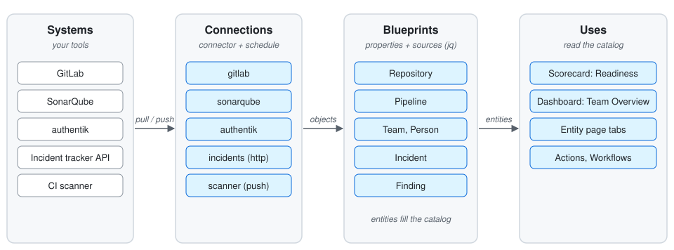

# How It Works

Golden Portal gives developers one place to see what they own, how it's doing, and what to fix, and to do routine work themselves. It's built on a catalog: your repositories, teams, pipelines and anything else you choose, kept in step with the systems that hold them.

You decide what the portal shows. You connect your systems, shape what the catalog holds, and build on it the standards entities are scored against, the dashboards people open, and the actions they run. Each of these is a YAML document you write in the portal's editors.

Connections bring data in, blueprints shape it into the catalog, and scorecards, dashboards and actions use the catalog.



## Concepts

- **[Document](#documents)**: what you write to set anything up, such as a connection or a dashboard.
- **[Connection](connectors/README.md)**: one system the portal reads, such as GitLab.
- **[Resource](connectors/README.md)**: something a connection reads from its system, such as GitLab `projects`.
- **[Sync](syncing.md)**: a connection reading its resources, such as every 15 minutes.
- **[Blueprint](blueprints.md)**: a kind of entity, such as repository or team, with its properties.
- **[Source](blueprints.md#sources)**: how a blueprint fills its entities from one resource, such as repositories from GitLab `projects`.
- **[Entity](blueprints.md)**: one row in the catalog, such as the repository `acme/payments/api`.
- **[Property](blueprints.md#properties)**: one field of an entity, such as its owner or CI status.
- **[Scorecard](scorecards.md)**: tiers of checks over one blueprint's entities, such as Readiness.
- **[Dashboard](dashboards.md)**: a Home tab of widgets, such as Team Overview.
- **[Action](actions.md)**: a self-service run on one entity, such as restarting a service.
- **[Workflow](workflows.md)**: a self-service run that can span many entities, such as restarting all of a team's services.

## Documents

To set anything up, such as connecting GitLab or adding a dashboard, you write a document: YAML in that thing's editor, live once you publish it. Every document has the same outline:

```yaml
kind: Connection  # or Blueprint, Scorecard, Dashboard, Action, Workflow
metadata:
  identifier: gitlab  # lowercase; can't change once published
  title: GitLab
  description: Our GitLab.        # optional
  icon: git-branch  # optional, shown beside the title
  color: orange  # optional, tints the icon
spec:
  connector:
    type: gitlab
    config:
      token:  # secrets come from the portal's environment
  # what goes here depends on the kind
        env: GP_SECRET_GITLAB_TOKEN
```

- `icon`: any [Lucide](https://lucide.dev/icons) icon name, such as `server`, `users` or `git-branch`.
- `color`: gray, red, orange, amber, yellow, lime, green, emerald, teal, cyan, sky, blue, indigo, violet, purple, fuchsia, pink or rose. The same names color badges and widgets.
